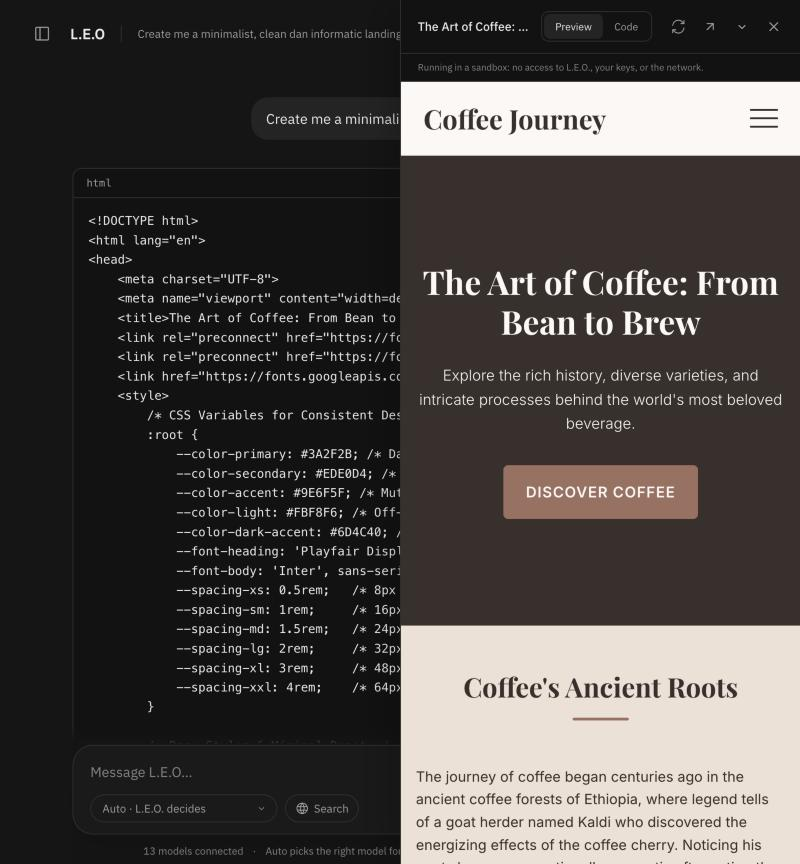
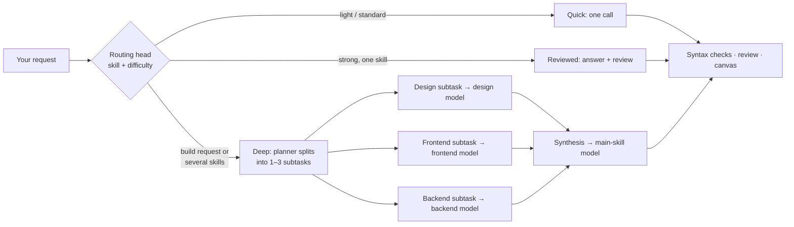
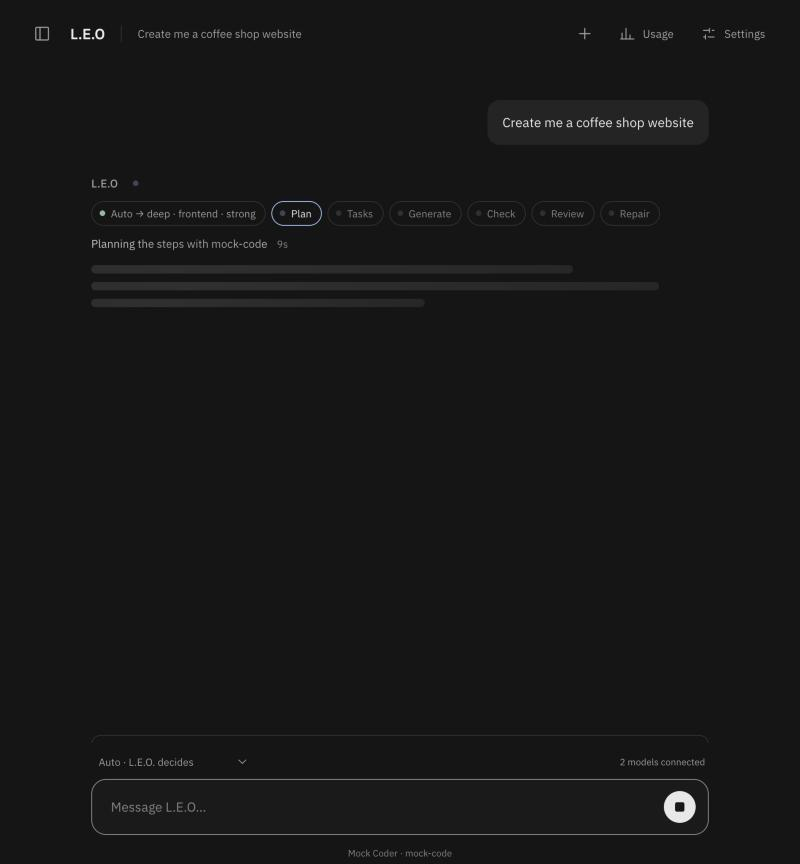
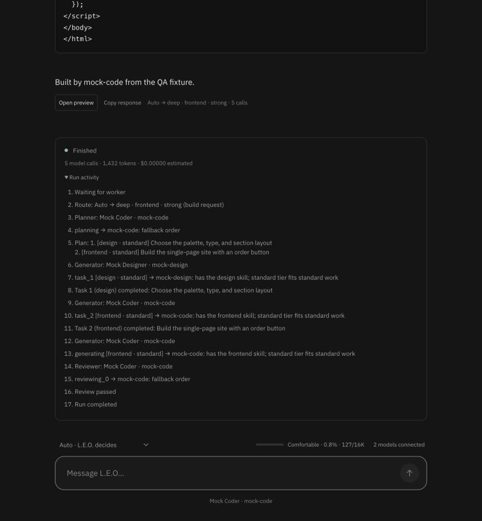
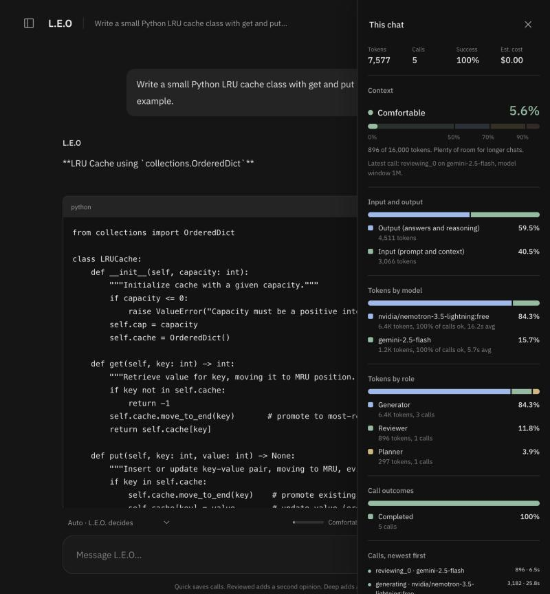
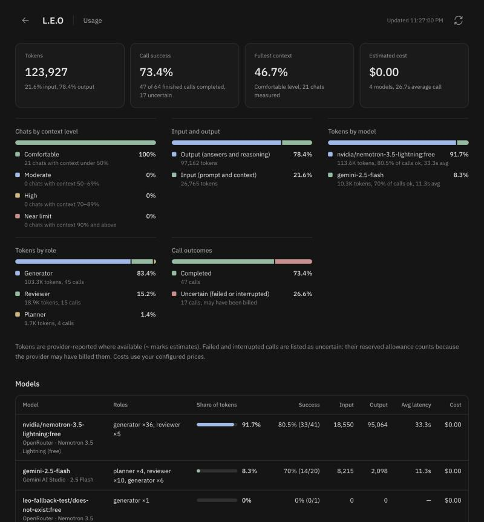
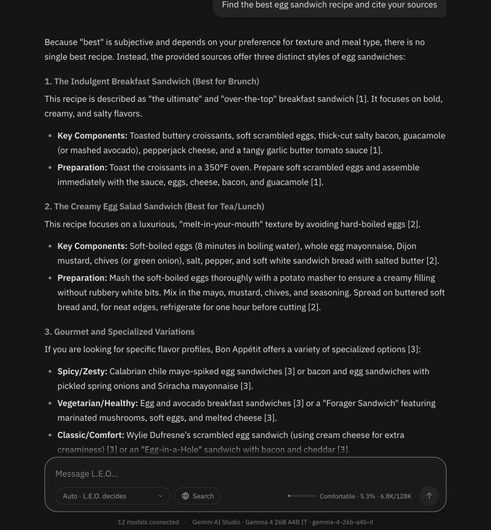
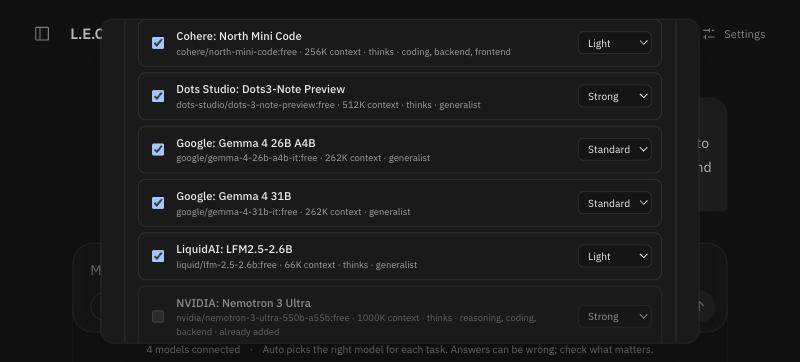
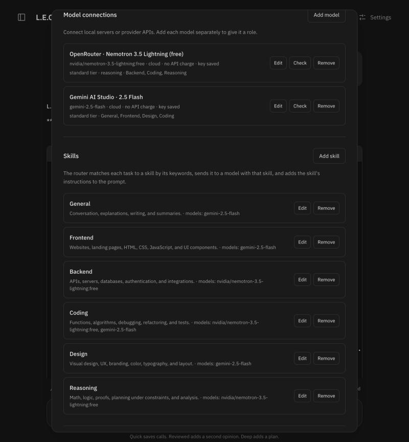

# L.E.O. — Language Model Efficiency Orchestrator

> **🚧 Work in progress (v0.2).** L.E.O. runs end to end and has an automated test suite, but it is still under active development. Routing rules, defaults, and the database schema may change without migrations. Benchmarks so far show token savings and resilience on everyday coding tasks, while multi-step builds still cost more tokens than one strong model (see [Benchmarks](#benchmarks)). Use it with your own models and keys; do not expose it to the internet without the access settings described below.

**Use your free and local models like a pro subscription.** L.E.O. connects the models you already have (Ollama, LM Studio, vLLM, every free model on OpenRouter, Gemini AI Studio, and paid APIs such as Claude if you choose) and puts a **routing head (HEAD)** in front of them. HEAD reads each task, decides what skill it needs and how hard it is, searches the web when the task needs current information, and sends each step to the cheapest model that can do it well, at a matching thinking effort. A quick question goes to a small model at low effort, code to a coding model, a website's design to your design model, and paid models only step in when free ones cannot.



<sub>"Create me a coffee shop website" in Auto mode: the request was split into a design task and a frontend task, each routed to its specialist, and the result runs live in the sandboxed canvas. Captured with the built-in QA fixture (mock models), so the page is fixture output.</sub>

## Contents

- [Why L.E.O.](#why-leo)
- [How the routing head works](#how-the-routing-head-works)
- [Screenshots](#screenshots)
- [Status](#status)
- [Quick start](#quick-start)
- [Connect models](#connect-models)
- [Discover models](#discover-models)
- [Skills and routing profiles](#skills-and-routing-profiles)
- [Web research](#web-research)
- [Paid models as a backup (Claude)](#paid-models-as-a-backup-claude)
- [Modes, limits, and context](#modes-limits-and-context)
- [Canvas](#canvas)
- [Usage and context tracking](#usage-and-context-tracking)
- [Use L.E.O. from Claude Code (MCP)](#use-leo-from-claude-code-mcp)
- [Benchmarks](#benchmarks)
- [Persistence and recovery](#persistence-and-recovery)
- [Docker / PostgreSQL](#docker--postgresql)
- [Security and execution boundaries](#security-and-execution-boundaries)
- [Development](#development)
- [Project structure](#project-structure)
- [Roadmap](#roadmap)

## Why L.E.O.

Most people send every request to one model. On a subscription that often means the biggest model at full effort, even for a one-line question. Without a subscription it means one free model doing everything, including work it is bad at.

L.E.O. is built for people who:

- have several free or local models and want them to **work as a team**;
- want **simple tasks on small models** and only hard tasks on strong ones;
- want to **see and limit** calls, tokens, cost, and context use for every chat.

## How the routing head works



0. **Research when needed.** If the request needs fresh or outside information ("cite sources", "latest", "price of", a link…), L.E.O. searches your SearXNG and reads the top pages first; see [Web research](#web-research).
1. **Classify (no tokens spent).** Keyword rules match the request to a skill: General, Frontend, Backend, Coding, Design, Reasoning, or skills you add. For a build request, the thing being built decides the main skill ("…a website" → Frontend). Signals such as a build request, scope words ("complete", "production"), several skills, several parts, or length set the difficulty: light, standard, or strong.
2. **Pick a mode (Auto).** Light and standard work → **Quick**. Strong single-skill work → **Reviewed**. Strong multi-skill work or a build request → **Deep**, where the planner labels each subtask with a skill and difficulty.
3. **Pick a model and an effort for every generator call.** Candidates are ranked: strong enough for the task → has the skill ("General" is not a specialty) → generalist → for light work, a model without hidden reasoning → the lightest tier that is enough → your model choice setting. With **Auto** (the default), every model you turned on competes: among models that fit, the cheapest per call wins. Free and local models cost nothing; a paid model's cost is estimated from its prices and the tokens it actually used in earlier calls, so a model that thinks at length counts as more expensive. Settings → Models shows each model's price and average tokens per call. Thinking models get a matching effort: low for light and standard work, medium for strong work. With **Free first**, paid models are a backup after three free attempts. A failed or rate-limited model is skipped and backs off exponentially (30 seconds up to an hour).
4. **Explain it.** The live view and the run log show each decision and its reason, for example `task_2 [frontend · standard] → gemini-2.5-flash: has the frontend skill; standard tier fits standard work`.

`POST /api/route` (and the MCP tool `leo_route`) previews the decision for any prompt without calling a model.

## Screenshots

| Live run with the routing decision | Routing log: each subtask goes to its specialist |
| --- | --- |
|  |  |
| Auto chose Deep for a frontend build. Stages light up as they run; placeholder lines appear until the first text arrives. *(QA fixture)* | Design task → design model, frontend task → frontend model, each with the reason. *(QA fixture)* |

| Per-chat usage panel | Usage across all chats |
| --- | --- |
|  |  |
| Context level (Comfortable / Moderate / High / Near limit) and every breakdown as a percentage. *(Real run: OpenRouter Nemotron + Gemini 2.5 Flash)* | Tokens, success rate, fullest context, and shares by model, role, and outcome. *(Real data)* |

| Web research with cited sources | Discover every model a key can use |
| --- | --- |
|  |  |
| "Find the best egg sandwich recipe and cite your sources": L.E.O. searched SearXNG, read three pages, and one free model (Gemma 4 26B) answered with [n] citations: 1 call, 6,761 tokens. *(Real run)* | OpenRouter: the free chat models your key can use, with suggested strength, thinking, and skills. *(Real data)* |

| Settings: routing profiles and skills |
| --- |
|  |
| Each connection has skills, a strength tier, and a reasoning flag. Each skill lists the models that have it. Keys are never shown. |

## Status

v0.2 is a working prototype, not a finished product.

**Working and tested** (82 automated tests plus browser checks):

- Connections to OpenAI-compatible, OpenAI Responses, and Anthropic Messages endpoints, with streaming and provider-reported usage, including hidden thinking tokens that some providers leave out of their output count. Live-tested with OpenRouter (12 free models) and Gemini AI Studio; a Claude key was connected and its catalog read, but no generation was tested (the account had no credits).
- HEAD: skills, routing profiles, Auto mode, per-subtask routing in Deep mode, effort by difficulty, model discovery, and fallback between providers (live: rate-limited models handed over to others with no failed runs).
- Web research through a self-hosted SearXNG, with safe page reading and cited answers (live-tested).
- Durable runs: background worker, checkpoints, crash recovery, Stop, resumable streams, history.
- Per-run limits on calls, tokens, time, and estimated cost; paid usage only with explicit opt-in, priced per call from each model's real token use under Auto routing.
- Chat with rendered Markdown, live run view, sandboxed canvas, per-chat and global usage views.
- MCP server over stdio (tested as a real subprocess and against live models).

**Not yet proven or not yet built:**

- **Builds cost more than one strong model.** On website and app tasks, Deep mode used 2–4× the tokens of a single strong model. Those runs predate two fixes (no review loop for design work in Auto, and the last subtask's result reused as the answer); a re-run is pending.
- **Free-tier limits dominate in practice.** Rate limits (429) and outages (503) hit Gemini, Laguna, and Gemma throughout testing. L.E.O. routes around them, which is its main practical advantage today.
- Review is a model's opinion. In a benchmark a reviewer approved code that fails on import. Generated code is never executed by the server.
- Not run yet: Docker Compose / PostgreSQL deployment, and live use of OpenAI, Qwen, OpenCode, Ollama, LM Studio, vLLM, and Claude generation.
- Single owner only: no multi-user accounts. The schema has no migrations yet.

## Quick start

Requires Python 3.11+, [uv](https://docs.astral.sh/uv/), and Node.js 22.12+ (Node 24 recommended).

```sh
./start.sh
```

That one command installs dependencies on first run, rebuilds the UI when its source changed, starts web search (SearXNG) if it is installed, runs the API and one durable worker, and opens **http://127.0.0.1:8000**. Ctrl+C stops everything. Your connections, keys, chats, and settings live in `.leo/`; to use another workspace folder, pass it: `./start.sh .leo-bench`. `make start` does the same, and `make dev` runs only the API and worker. Dependencies are locked in `uv.lock` and `frontend/package-lock.json`.

For frontend development, run `make frontend` in another terminal and open **http://127.0.0.1:4321**. Astro proxies `/api` to port 8000. Rebuild with `make build` to update the frontend served on port 8000.

No model is downloaded and no provider is contacted during setup. Add your own connection to generate answers.

## Connect models

1. Open **Settings → Add provider** and choose a provider preset.
2. Set the API base URL and exact model ID. Enter an API key if the endpoint requires one; keys are encrypted on the server and never shown again.
3. Set the **routing profile**: skills, strength (light, standard, strong), and **Reasoning model** if it spends hidden thinking tokens. Presets suggest one.
4. **Save**, then **Check** to test the model catalog. This does not send a generation request; manual model IDs work when a provider has no compatible catalog.
5. Click **Add models** on the provider to add every other model the same key can use (see [Discover models](#discover-models)), or add models by hand. A new connection can also **reuse a saved key** for the same host. Settings lists one collapsible row per provider with its models inside; each model's switch turns it on or off. Optionally assign planner and reviewer roles.
6. For a paid model, enter input/output prices per million tokens and enable **Allow paid API usage**. Prices are your estimates, not live billing data. Cloud connections without a key are flagged in Settings.

| Provider | Preset / protocol | Suggested profile |
| --- | --- | --- |
| Ollama | `http://localhost:11434/v1`, Chat Completions; pull a model yourself | General · light |
| vLLM / LM Studio | Your server URL (LM Studio is usually port 1234); Chat Completions | General · standard |
| OpenRouter | `https://openrouter.ai/api/v1`; Chat Completions | Set per model |
| OpenAI / GPT | `https://api.openai.com/v1`; Responses | Coding, Backend, Reasoning · strong |
| Anthropic / Claude | `https://api.anthropic.com/v1`; Anthropic Messages | Coding, Backend, Frontend, Reasoning · strong |
| Qwen / Alibaba Cloud | DashScope OpenAI-compatible API for your region | Coding, General · standard |
| OpenCode | OpenCode inference API; use a model available to external clients | Coding · standard |
| Google Gemini (AI Studio) | Gemini OpenAI-compatible API | Frontend, Design, General · standard |
| Other models | Any endpoint speaking one of the three protocols | Set per model |

Presets are editable. Provider eligibility, model names, free quotas, and prices change often. A ChatGPT or Claude chat subscription is not API access; connecting an API key uses API billing. **No API charge** means you have verified the endpoint is free for this usage. It does not stop a provider from billing you if it is set incorrectly.

## Discover models

A key usually unlocks many models. **Add models** on a provider reads the provider's whole catalog and suggests a routing profile for each chat model:

- **OpenRouter:** free models only (price 0 or a `:free` ID). Audio models, safety filters, and router aliases are left out.
- **Gemini AI Studio:** text chat models from the native catalog. Image, speech, audio, live, embedding, robotics, and agent products and `-latest` aliases are left out.
- **Anthropic:** Claude 4.5 and later, with suggested list prices you can edit.
- **Other OpenAI-compatible servers:** whatever their `/models` lists.

Profiles come from the catalog itself: strength from size and family (e.g. 550B, Pro, Opus → strong; Flash-Lite, Mini, Haiku, small sizes → light), thinking from what the provider reports, and coding skills only for models the provider describes as coding models. With **Check access first** (on by default), L.E.O. sends one tiny request per model and skips the ones your key cannot use, with the reason (not on your plan, rate-limited, timed out); a model that rejects an effort setting is kept with effort off. Selected models are added in one click, reusing the saved key.

## Skills and routing profiles

**Settings → Skills** manages the skills the router matches on. Each skill has a name, a description (shown to the Deep-mode planner), keywords (matched as whole words), instructions added to the prompt whenever a model works on that skill, and an on/off switch. Six starter skills are created on first start; edit, disable, delete, or add your own, such as "Data analysis" with keywords `pandas, dataframe, chart`.

A connection with no skills is a **generalist**: it can take any task but loses ties to a specialist. Give strong-but-expensive models the **strong** tier so they are used only for strong work, and mark reasoning models so they are not used for simple questions.

Turn off **Match tasks to skills** in Settings → Routing to go back to fixed roles: the generator assignment and model choice setting decide.

## Web research

HEAD searches only when a request needs fresh or outside information: explicit intent such as "search for", "latest", "news", "price of", "how much does", "sources", "cite", "according to", "weather", or a link in the message. Plain questions ("Make me a recipe for an egg sandwich") are answered from model knowledge, because reading pages is the most expensive part of a run. The 🌐 **Search** toggle in the message box forces research for one message.

- **Simple research:** L.E.O. searches with your words, reads the top pages (3 by default), and one model answers citing them as [n]. The search costs no model tokens.
- **Deep runs:** the planner can plan its own search tasks with up to three queries; only those tasks receive the page text.
- **Safety:** pages are fetched only from public addresses (never your local network or cloud metadata services, including after redirects), capped in size and time, stripped to readable text (about 8,000 characters per page), and passed to models as information, never as instructions.

Search uses your own [SearXNG](https://github.com/searxng/searxng) instance with JSON output enabled (`deploy/searxng/settings.yml`). `./start.sh` starts it automatically when it is installed from source in `<workspace>/searxng` (a `venv` with SearXNG's requirements plus its `src` checkout), or uses one already running on port 8888. With Docker: `docker compose up searxng`. Then set **Settings → Web search** to `http://localhost:8888` and click **Test search**.

## Paid models as a backup (Claude)

Connect a paid API (for example Anthropic Claude: preset **Anthropic / Claude**, then **Models** to add Haiku, Sonnet, and Opus), enable **Allow paid API usage**, and set a **Max cost per run** (Settings → Routing). With **Auto**, a paid model is chosen when it fits the task better than the free ones, or when it is the cheapest fit (Haiku for light, Sonnet for standard, Opus for strong work). Choose **Free first** to treat paid models strictly as a backup: each step then tries up to three free models, then the paid model that fits, then the remaining free models. L.E.O. reserves the worst-case cost before every paid call and stops before the cap. Claude receives a thinking-effort setting by difficulty, refusals hand the step to the next model, and an empty provider balance is reported as such.

## Modes, limits, and context

- **Auto** (default): the routing head picks one of the modes below.
- **Quick:** one generation call plus local syntax checks.
- **Reviewed:** generation → syntax checks → a reviewer's JSON verdict → bounded repair and re-review. An invalid verdict counts as unverified, never as a pass.
- **Deep:** a validated plan of 1–3 subtasks, run in dependency order (each routed by its own skill) → synthesis → review and repair.

Every call counts toward the per-run limits on calls, tokens, time, and estimated cost, including planning, review, repair, and failed attempts. Before each request L.E.O. reserves a conservative input estimate plus the output cap. Provider-reported usage replaces the estimate afterwards. Failed or interrupted calls keep their reservation because they may have been billed.

Older conversation turns are dropped as whole turns when a request would exceed the context allowance; the current request and system instructions are always kept. Oversized requests fail with a clear error.

## Canvas

When an answer contains an HTML page, its code streams into the canvas while it is written, then runs as a live preview. Separate CSS and JavaScript blocks are merged in. Use **Preview / Code**, **Run again**, **Open in a new tab**, or **Download**; **Open preview** on any earlier answer reopens it.

The page runs in a sandboxed frame without same-origin access, so its scripts cannot read L.E.O.'s cookies, storage, or API. A content security policy blocks network requests from the page. Only web pages run in the canvas; nothing generated runs on the server.

## Usage and context tracking

- **Context meter** (next to the message box): the active chat's level and percentage, e.g. `Comfortable · 15.7% · 2.5K/16K`.
- **Per-chat panel** (header **Usage** button): context level meter, tokens, success rate, cost, and percentage breakdowns: input vs output, tokens by model, tokens by role, call outcomes (completed, in progress, uncertain), plus every call with its model.
- **Usage page** (`/usage/`): the same across all chats, plus chats by context level, a per-model table with share of tokens and success rate, and a log of recent calls showing routing and fallback.

Context levels: **Comfortable** under 50%, **Moderate** 50–69%, **High** 70–89%, **Near limit** 90% and above (older turns are being trimmed). Context is the latest completed call's input + output against the lower of the model's window and Settings → Context tokens.

## Use L.E.O. from Claude Code (MCP)

L.E.O. includes an MCP server (stdio) that calls your running L.E.O. API, so other agents can hand work to your routed models:

```sh
claude mcp add leo -- uv run --directory /path/to/L.E.O python -m backend.mcp_server
```

| Tool | What it does |
| --- | --- |
| `leo_ask` | Send a request (mode `auto` by default); returns the answer, the route, the models used per stage, token usage, and a `conversation_id` to continue the chat |
| `leo_route` | Preview the routing decision without calling a model |
| `leo_usage` | Tokens, calls, cost, and context per model, overall or for one conversation |
| `leo_models` | List connections with their skills, tier, and reasoning flag |

Set `LEO_API_URL` if the API is not at `http://127.0.0.1:8000`, and `LEO_API_TOKEN` when the server requires a token. The MCP server adds no capability beyond the API.

## Benchmarks

`benchmarks/run.py` sends the same prompts to single models directly ("one app, one model", like using the Gemini app) and to L.E.O. It checks coding answers against hidden acceptance tests (run in a macOS sandbox with network and writes blocked), scores websites with a 14-point rubric (complete page, mobile viewport, menu with prices, call to action, hours or contact, responsive layout, interactivity, accessibility…), and checks the long app task for its required features. `benchmarks/report.py` merges result files and recomputes L.E.O.'s **actual** tokens from each run's call ledger; unbilled reservations of failed calls are shown separately.

```sh
LEO_DATA_DIR=.leo-bench uv run python -m benchmarks.run --single gemini-3.5-flash --single <other model> --leo auto
uv run python -m benchmarks.report benchmarks/results/<file>.json [...]
```

Tasks: six coding functions with edge cases, "Create me a coffee shop website", "Create a landing page with a clean, minimalist design for a note-taking app", and a long task: a complete personal finance tracker in one HTML file.

### 30 Oct 2026: L.E.O. Auto with a team of free models

L.E.O.'s team: Gemini 2.5 Flash, Laguna S (coding), Nemotron 3.5 Lightning (reasoning), and Nemotron 3 Ultra 550B (strong), all free. Baselines: Gemini 3.5 Flash alone (closest to the free Gemini app) and Nemotron 3 Ultra alone. Thinking tokens are counted.

| Approach | Correct | Blocked by provider | Tokens per correct task | Mean time |
| --- | --- | --- | --- | --- |
| Gemini 3.5 Flash alone | 2/2 | 7 of 9 (free quota exhausted) | 2,746 | 17 s |
| **L.E.O. Auto** | **8/9** | **0** | 14,822 | 116 s |
| Nemotron 3 Ultra alone (pages and app only) | 2/3 | 0 | 20,143 | 347 s |

| Task | Gemini 3.5 Flash | L.E.O. Auto | Nemotron 3 Ultra |
| --- | --- | --- | --- |
| roman | ✅ 3,446 | ✅ **1,803** | — |
| intervals | ✅ 2,047 | ✅ **1,601** | — |
| duration, top-k, LRU | rate-limited | ✅ 1,430 · 537 · 640 | — |
| ipv4 | rate-limited | ❌ accepted Arabic-Indic digits | — |
| coffee shop website | rate-limited | ✅ rubric 100%, 21,707 | ✅ rubric 100%, **11,481** |
| minimalist landing page | rate-limited | ✅ rubric 93%, 36,599 | ❌ rubric 71%, 16,418 |
| finance tracker app | rate-limited | ✅ all features, 52,830 | ✅ all features, **12,387** |

**What this shows**

- **Everyday coding: L.E.O. used fewer tokens** than Gemini 3.5 Flash alone on every task both answered (−48% and −22%), by routing to a coding model and giving thinking models low effort.
- **Resilience: L.E.O. answered every task**, while the single free model was blocked by its quota after two. Routing across many free models is L.E.O.'s clearest advantage today.
- **Builds: L.E.O. cost 2–4× the tokens of one strong model.** Splitting a page across models, plus a review-and-repair loop, costs more than one capable model writing it once. Two fixes since then (no review loop for design work in Auto; the last subtask's result reused as the answer) target this; a re-run is pending.
- **Quality on pages:** L.E.O. passed all three page/app checks; Nemotron Ultra alone missed the landing page's footer, contact details, interactivity, and a complete document.
- **Shared limits:** most models, including L.E.O.'s, failed the IPv4 edge case. Routing cannot add knowledge the models lack.

### 29 Oct 2026: before smart routing

Nemotron 3.5 Lightning (cheap) and Gemini 2.5 Flash (strong); L.E.O. used a fixed generator (Nemotron). Gemini's thinking tokens were not yet counted, so its numbers are understated.

| Approach | Passed | Tokens per passed task | Mean calls |
| --- | --- | --- | --- |
| Gemini 2.5 Flash alone | 5/6 (1 rate limit) | 1,406 | 1.3 |
| Nemotron alone | 5/6 | 5,337 | 1.0 |
| L.E.O. Quick (fixed generator) | 4/6 | 4,814 | 1.2 |
| L.E.O. Reviewed | 4/6 | 9,132 | 2.3 |
| L.E.O. Deep | 3/3 | 18,813 | 6.3 |

This run exposed the problems fixed in v0.2: a fixed generator, a reasoning model running out of output before answering, uncounted thinking tokens, a context bug in Deep mode, and review approving code that fails on import.

Full results are in `benchmarks/results/`. Samples are small; treat differences as indicative, not statistically significant. Still to do: re-run the builds with the 12-model team after the fixes, judge page designs visually, and test Claude generation once its account has credits.

## Persistence and recovery

Local development uses SQLite with WAL in `.leo/`. PostgreSQL uses the same SQLAlchemy schema and is configured in Compose. The database holds connections, settings, skills, conversations, messages, runs, events, and per-call usage records.

The API enqueues runs; a separate worker claims one at a time with a renewable 30-second lease. After a crash, expired runs are reclaimed, completed stages are reused, interrupted calls are marked as such (their reservation still counts), and remaining stages continue. Stream event IDs support reconnect and replay. Closing the browser does not cancel a run; **Stop** does.

Provider calls are at-least-once: a crash during a request can lead to the request being sent again. This is not an exactly-once billing guarantee.

To run the processes separately:

```sh
uv run uvicorn backend.api:create_app --factory --host 127.0.0.1 --port 8000
# In another terminal, after the API has initialized the database:
uv run python -m backend.worker
```

Both must use the same database and encryption key. Back up the database **and** `.leo/secret.key` together (or keep `LEO_ENCRYPTION_KEY` in a secret manager); without the key, saved API keys cannot be read.

## Docker / PostgreSQL

```sh
cp .env.example .env
# Set a strong LEO_DB_PASSWORD and, when needed, LEO_API_TOKEN.
docker compose up --build
```

Compose runs the API, the worker, and PostgreSQL, with port 8000 bound to the host's loopback interface. **This setup has not been run yet** (no Docker host was available); expect to smoke-test it. Inside containers, reach host Ollama at `http://host.docker.internal:11434/v1`. `.env` is read by Compose only; export variables in your shell for local Python commands. Settings are documented in `.env.example`.

## Security and execution boundaries

- **Single-owner workspace.** The dev launcher binds to loopback. The API refuses to start when `LEO_ALLOWED_HOSTS` names a non-loopback host and `LEO_API_TOKEN` is empty. For remote access, set `LEO_API_TOKEN`, exact `LEO_ALLOWED_ORIGINS` and `LEO_ALLOWED_HOSTS`, and put HTTPS in front. The token grants the whole workspace; there are no per-user accounts.
- **Keys.** Provider API keys are encrypted at rest (Fernet) and never returned by the API. Browser storage holds only the theme, panel state, and the selected conversation ID.
- **Origins.** Unexpected browser origins and hostnames are rejected. Arbitrary provider URLs, including local and private addresses, are an owner-only setting by design.
- **Generated code.** The server only parses Python and JSON for syntax; it never runs generated code, edits your files, runs shell commands, or deploys anything. The only thing that runs is a generated web page, in the browser canvas sandbox. Chat messages render model output as text, never as HTML in the app.

## Development

```sh
make check   # backend tests + frontend type check
make build   # build the frontend served by the API
```

The backend suite (82 tests) covers routing classification and ranking, web research and page-reading safety, model discovery, per-subtask routing, Auto mode, skills, the MCP server over stdio, protocol streaming and usage, fallback and cooldown, paid opt-in and limits, key encryption, origin/host/token checks, idempotent submission, cancellation, context trimming, review and repair, task dependencies, checkpoint recovery, and usage reporting. Tests use deterministic HTTP transports and never call real providers.

For manual browser testing without real models, run the QA fixture and connect it with model `leo-test-model` (local, no API charge), using a separate `LEO_DATA_DIR`:

```sh
uv run uvicorn tests.mock_provider:app --host 127.0.0.1 --port 9011
```

It returns clearly labeled fixture output, including a skill-labeled plan and a sample web page for the canvas. Set `LEO_MOCK_DELAY=0.35` to slow streaming down and watch the live view.

Interactive API docs are at `/api/docs` while the backend runs. The product requirements live in [`spec-driven.md`](spec-driven.md).

## Project structure

| Path | Purpose |
| --- | --- |
| `backend/router.py` | HEAD: starter skills, classification, search cues, Auto mode, effort, model ranking |
| `backend/tools.py` | Web search (SearXNG) and safe page reading |
| `backend/discovery.py` | Model discovery and automatic routing profiles |
| `backend/orchestrator.py` | Per-task routing, budgets, planning, subtasks, review, and repair |
| `backend/providers.py` | Chat Completions, Responses, and Anthropic streaming adapters |
| `backend/store.py` | Persistence, encrypted keys, skills, job leases, usage ledger and reports |
| `backend/api.py` | HTTP API, owner access, resumable event stream |
| `backend/worker.py` | Durable background worker and cancellation |
| `backend/context.py` | Context selection, plan validation, syntax checks |
| `backend/mcp_server.py` | MCP server for Claude Code and other clients |
| `frontend/src/scripts/chat.ts` | Chat, settings, skills, model discovery, live run view |
| `frontend/src/scripts/markdown.ts` | Safe Markdown rendering for answers (DOM only, no HTML) |
| `frontend/src/scripts/canvas.ts` | Sandboxed live preview of generated pages |
| `frontend/src/scripts/usage-ui.ts`, `usage.ts` | Context levels and percentage breakdowns |
| `benchmarks/` | Tasks with hidden tests, the comparison runner, results |
| `tests/` | Backend test suite and the QA mock provider |
| `spec-driven.md` | Product requirements and technical specification |

## Roadmap

- Re-run the build tasks with the full free-model team after the Deep-mode fixes, and judge page designs visually.
- Test Claude generation (Haiku, Sonnet, Opus as paid backup) once the account has credits.
- Read each provider's own retry window so daily-quota exhaustion is detected, not just retried later.
- Run acceptance tests in an isolated execution service so review can be checked by real tests.
- Learn routing from results: tune skills, tiers, effort, and Auto thresholds from benchmark outcomes instead of hand-set rules.
- More tools for HEAD to plan (code execution in a sandbox, files) and MCP client support, with explicit per-tool permissions.
- Database migrations, a Docker smoke test, and multi-user accounts before any shared hosting.

---

L.E.O. is a work in progress. Issues and suggestions are welcome. No license has been chosen yet, so all rights are reserved by the author until one is added.
