<div align="center">

<picture>
  <source media="(prefers-color-scheme: dark)" srcset="docs/assets/banner-dark.png">
  <source media="(prefers-color-scheme: light)" srcset="docs/assets/banner-light.png">
  
</picture>

<br>


**[Quick start](#quick-start)** · **[Architecture](#architecture)** · **[The harness algorithm](#the-harness-algorithm)** · **[Tech stack](#tech-stack)** · **[Screenshots](#screenshots)** · **[Benchmarks](#benchmarks)**

</div>

**L.E.O.** (LLM Efficiency Orchestrator) lets you use the models you already have the way a pro subscription would. That
includes Ollama, LM Studio, vLLM, every free model on OpenRouter, Gemini AI Studio, ChatGPT or Copilot sign-ins, and
paid APIs such as Claude if you allow them. A **routing head (HEAD)** reads each task, decides which skill it needs and
how hard it is, and sends it to the cheapest model that can do it well, at a matching thinking effort. Where checking
pays off, it adds a review by a different model.


<sub>*"Create me a minimalist, clean dan informatic landing page about coffee"* in Auto mode. HEAD saw one
self-contained page and chose `Auto → quick · frontend · standard`: one call to a free model (Gemini 2.5 Flash), 9,206
tokens, 36 s. The page uses real Wikimedia photos with their photographers credited, and runs in the sandboxed preview
at desktop width. *(Real run)*</sub>

> [!WARNING]
> **Work in progress.** Everything below runs end to end and is covered by tests, but routing rules, defaults, and the
> database schema can still change without migrations. Do not expose a server to the internet without the
> [access settings](#security).

## One engine, three ways in

| | What it is | Where models run |
| --- | --- | --- |
| **L.E.O Chat** | The web app. HEAD routes every message across all your models: Quick, Reviewed, or Deep (planned) runs, web research with citations, real photos for pages, a live preview, connectors (remote MCP servers) with per-tool permissions, and usage down to every call. | On the server, by a durable background worker |
| **L.E.O.C.O.D.E** (`leocode`) | A terminal coding agent in the spirit of Claude Code and Codex. It signs in to your L.E.O. account, then works in your folder with a **tree of agents**: your strongest model directs and reviews, cheaper models do the volume. | On your machine; code and transcripts stay local, only usage totals go back |
| **MCP server** | `leo_ask`, `leo_route`, `leo_usage`, `leo_models` over stdio, so Claude Code or any MCP client can hand work to your routed models. | Through your running L.E.O. API |

All three share one Python engine (`backend/`): the same routing, budgets, fallback, checkpoints, and call ledger.

## Quick start

### The web app

You need Python 3.11+, [uv](https://docs.astral.sh/uv/), and Node.js **22.23.4 or newer** (Astro 7 requires it; Node 24
recommended).

```bash
./start.sh
```

On first run this installs the dependencies, rebuilds the UI when its source changed, and starts web search (SearXNG)
if it is installed. It then runs the API and a durable worker and opens **http://127.0.0.1:8000**. Ctrl+C stops
everything. Your accounts, models, encrypted keys, chats, and settings live in `.leo/`. Pass another folder to use a
different workspace, for example `./start.sh .leo-bench`.

Create the first account, then open **Settings → Models → Add provider**. Paste a key (a free OpenRouter or Gemini AI
Studio key is enough) and use **Add models** to choose which models L.E.O. may use. No model is downloaded and no
provider is contacted until you do.

### The terminal agent

```bash
uv tool install ./leo-cli          # or: npm install -g leo-orchestrator
cd my-project
leocode                            # signs in on the L.E.O. website the first time
```

See [leo-cli/README.md](leo-cli/README.md) for sign-in, approvals, skills, MCP servers, and every slash command.

### Docker (PostgreSQL, sandboxes, account sign-ins)

```bash
cp .env.example .env               # set a strong LEO_DB_PASSWORD
docker compose up --build
```

## Architecture

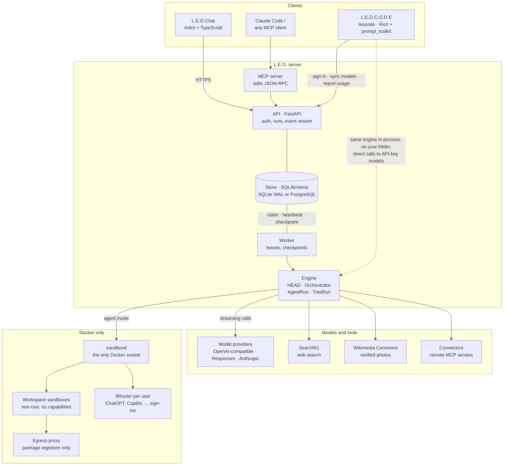

**How the pieces fit together**

- **The API never calls a model.** `POST /api/runs` stores a run as `queued` with an idempotency key and returns. The
  browser follows `GET /api/runs/{id}/events`, a resumable event stream: every event has an ID, so a reconnect replays
  what it missed. Closing the tab does not cancel a run; **Stop** does.
- **The worker owns execution.** It claims the oldest ready run with a 30-second lease and renews it every half second.
  It runs the engine and checkpoints the run's state after every stage. If a worker dies, another one reclaims the run
  once the lease expires, marks interrupted calls as such, reuses completed stages, and carries on.
- **The engine is one library.** HEAD (`router.py`), the orchestrator (`orchestrator.py`), the agent loop (`agent.py`),
  and the tree of agents (`tree.py`) know nothing about HTTP. The server runs them in the worker. L.E.O.C.O.D.E imports
  them in-process and swaps the Docker sandbox for `LocalWorkspace`, your folder, guarded by an approval policy.
- **Everything is in the store.** Users and sessions, model connections (keys Fernet-encrypted), skills, settings,
  conversations, runs with their state, events, and a per-call **ledger** (stage, model, reserved and actual tokens,
  cost, latency) that budgets, the Usage page, and `/usage` in the CLI are all computed from.

<details>
<summary><b>A run, step by step</b></summary>

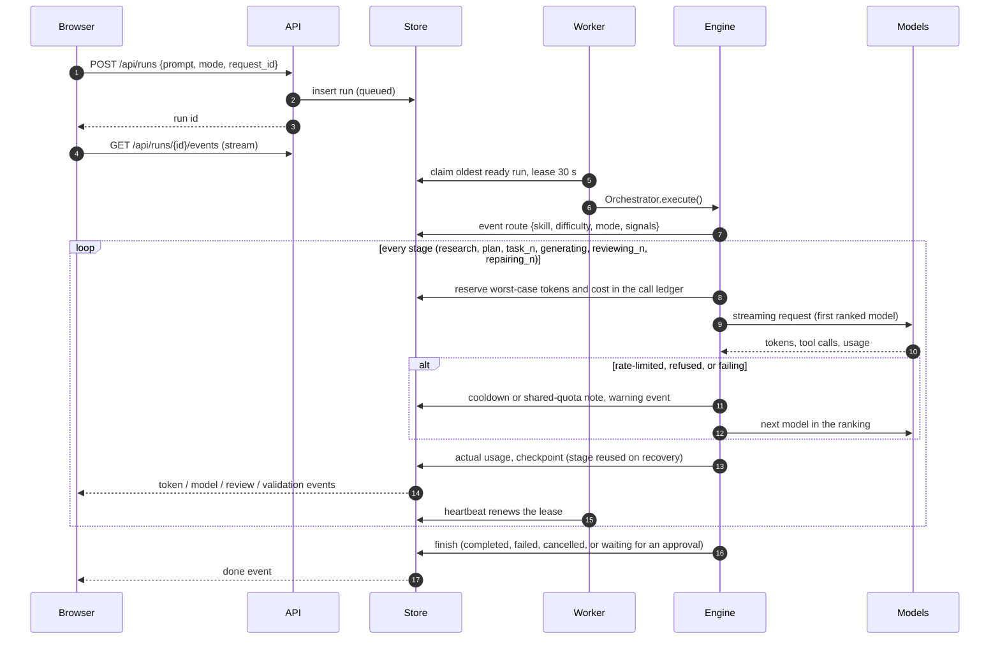

</details>

<details>
<summary><b>Source map</b></summary>

| Path | Responsibility |
| --- | --- |
| [`backend/router.py`](backend/router.py) | HEAD: starter skills, rule-based classification, search cues, Auto mode, effort, model ranking |
| [`backend/orchestrator.py`](backend/orchestrator.py) | Model calls with fallback, budgets and reservations, rate limits and quotas, research, photos, Quick/Reviewed/Deep pipelines |
| [`backend/agent.py`](backend/agent.py) | The agent loop: tools, parallel delegation, approvals, steering, context compaction |
| [`backend/tree.py`](backend/tree.py) | The tree of agents for L.E.O.C.O.D.E: levels, delegation, evidence, review and retries |
| [`backend/context.py`](backend/context.py) | Token bounds, context trimming, static checks, plan and review parsing |
| [`backend/providers.py`](backend/providers.py) | Chat Completions, Responses, and Anthropic streaming adapters, tool-call assembly, error mapping |
| [`backend/chat_tools.py`](backend/chat_tools.py), [`connectors.py`](backend/connectors.py), [`mcp_client.py`](backend/mcp_client.py), [`mcp_auth.py`](backend/mcp_auth.py) | Connectors: remote MCP over Streamable HTTP, OAuth with PKCE and dynamic registration, per-tool permissions |
| [`backend/tools.py`](backend/tools.py) | SearXNG search, safe page reading (public addresses only), Wikimedia photos |
| [`backend/discovery.py`](backend/discovery.py), [`catalog.py`](backend/catalog.py) | Model discovery and suggested routing profiles |
| [`backend/store.py`](backend/store.py), [`schemas.py`](backend/schemas.py) | Persistence, encryption, leases, the call ledger, usage reports; validated settings |
| [`backend/api.py`](backend/api.py), [`auth.py`](backend/auth.py), [`oauth.py`](backend/oauth.py) | HTTP API, sessions, password and Google/GitHub/OIDC sign-in, CLI device sign-in |
| [`backend/worker.py`](backend/worker.py), [`dev.py`](backend/dev.py) | Durable worker; local launcher for API + worker |
| [`backend/sandbox.py`](backend/sandbox.py), [`sandboxd.py`](backend/sandboxd.py), [`egress.py`](backend/egress.py) | Agent sandboxes: client, container daemon, egress allowlist proxy |
| [`backend/ninerouter.py`](backend/ninerouter.py) | Per-user 9Router for subscription sign-ins (ChatGPT/Codex, Copilot, Kiro, …) |
| [`backend/mcp_server.py`](backend/mcp_server.py) | L.E.O. as an MCP server |
| [`leo-cli/leo_cli/`](leo-cli/leo_cli) | L.E.O.C.O.D.E: `app.py` (entry), `ui.py` (prompt and rendering), `sessions.py`, `workspace.py` (your folder), `policy.py` (approvals), `treeview.py`, `account.py` (sign-in and sync), `mcp.py`, `skills.py`, `mentions.py` |
| [`frontend/src/`](frontend/src) | Astro pages; `scripts/chat.ts` (chat, settings, live run view), `markdown.ts` (safe rendering), `canvas.ts` (sandboxed preview), `usage*.ts` |
| [`benchmarks/`](benchmarks) | Tasks with hidden tests, comparison runner, QA grader, results |
| [`tests/`](tests), [`leo-cli/tests/`](leo-cli/tests) | Test suites, a mock provider, and a mock MCP server |
| [`spec-driven.md`](spec-driven.md), [`docs/superpowers/`](docs/superpowers) | Product requirements and design records |

</details>

## The harness algorithm

The "harness" is everything between your message and the models: classifying the task, choosing a pipeline and a model,
calling it safely, checking the result, and, for agents, running the tool loop and the tree. The rest of this section
describes the code as it is in this repository.

### 1. HEAD classifies the task, with no tokens spent

[`classify()`](backend/router.py) is pure rules over the text:

1. **Skill.** Each enabled skill has keywords, matched as whole words. The highest score wins, and ties go to a specific
   skill over General. If the request builds something (*build, create, make, develop, design, generate … app, page,
   API, game …*), the noun being built decides the skill. *"Create a landing page with a pricing table"* is Frontend,
   however often other keywords appear.
2. **Signals.** Single-page build, build request, scope words (*complete, production, secure, end-to-end, multi-page*),
   three or more skills involved, several parts (lists, *"and also"*, *"then"*), and a long request (over 1,200
   characters).
3. **Difficulty.**

   | Difficulty | When |
   | --- | --- |
   | **light** | A short question (*what, why, how does, explain, translate…*, at most 160 characters, no signals), or nothing that points higher |
   | **standard** | Any signal, a request over 280 characters, or a coding, backend, reasoning, or frontend task |
   | **strong** | A build request, two scope signals, or one scope signal across two skills |

4. **Checkable?** Two or more requirement words (*only, exactly, must, raise, invalid, edge case, at most…*) mean the
   answer can be checked against stated rules.
5. **Needs the web?** Explicit cues (*latest, news, price of, sources, cite, according to, weather…*) or a URL in the
   message. Plain questions are answered from model knowledge, because reading pages is the most expensive part of a
   run.

The decision is saved in the run's state and shown under the answer, for example
`Auto → reviewed · coding · standard · 4 calls`. `POST /api/route` and the MCP tool `leo_route` preview it for any
prompt without calling a model.

### 2. Auto picks a pipeline

| Pipeline | Chosen by Auto when | Calls |
| --- | --- | --- |
| **Quick** | Light and standard work, and a single self-contained page | 1 generation, local static checks, at most one repair if a check fails |
| **Reviewed** | Standard **checkable** coding, backend, or reasoning work; strong single-skill work | generation → static checks → a different model reviews → bounded repair and re-review |
| **Deep** | Strong work across two or more skills, or a build request | planner → 1–3 subtasks in dependency order, each routed by its own skill → synthesis → review where it pays |

Auto reviews only coding, backend, and reasoning. Reviews of design and prose mostly produce cosmetic notes and full
rewrites, so they cost more than they return.

### 3. Rank the models, then choose an effort

[`rank()`](backend/router.py) sorts every enabled, eligible model by this key, in order:

1. **Strong enough** for the difficulty (a model too light is used only if nothing else is left).
2. **Has the skill**, then generalist, then a specialist in something else.
3. With **Auto** routing: the **cheapest per call**. Free and local models cost 0. A paid model is priced from its own
   average tokens per call in the ledger (3,000 in / 1,500 out until it has history).
4. For light work, no hidden reasoning.
5. The **lightest tier that is enough**.
6. Then local first (Auto, Local first) or free first (Free first), then your priority number.

Planner, reviewer, and agent roles instead take the **strongest** model available, and a reviewer never grades an
answer its own model wrote. Reasoning models get an effort by difficulty: `low` for light and standard work, `medium`
for strong work and for page builds.

### 4. Every call goes through one guarded loop

[`Orchestrator.call()`](backend/orchestrator.py) is the only way the engine talks to a model:

```text
if this stage completed before (a resumed run):  return the saved result
queue = ranked candidates − disabled − cooling down − accounts at their shared limit
for model in queue:
    fit the context: keep system + request, drop the oldest whole turns that do not fit
    reserve: input bound (UTF-8 bytes / 3) + output cap; stop if calls, tokens, or cost would exceed the run's budget
    stream the response (text, tool calls, usage), publishing tokens as events
    on success: replace the reservation with provider-reported usage, checkpoint, return
    on failure:
        429 with a short wait (≤ 20 s) on the first choice  → wait once and retry it, rather than use a weaker model
        account-wide limit (e.g. OpenRouter free requests a day) → skip every model on that account until it resets
        retryable error  → cooldown of 30 s × 2^(failures − 1), up to an hour; try the next model
        no text but the output limit was hit → the model thinks; mark it as a reasoning model from now on
        tool definitions rejected → mark the model as unable to call tools
raise with a short list of why each model failed
```

Failed and interrupted calls **keep their reservation**, because the provider may have billed them. Paid models are
used only with **Allow paid API usage** on, within **Max cost per run**. With **Free first**, each step tries up to
three free models before a paid backup.

### 5. Check and repair

- **Static checks** ([`static_review()`](backend/context.py)) parse Python with `ast` and JSON with `json`. They also
  flag several versions of one function, in-page links to ids that do not exist, and placeholder text. The server
  never executes generated code.
- **Review** asks a stronger model, other than the author, for `{"passed": bool, "issues": [...]}`. The prompt makes it
  list every stated requirement, trace the code by hand on the request's examples, and watch for look-alike checks
  (`str.isdigit()` accepts non-ASCII digits). An invalid verdict counts as **unverified, never as passed**, and failing
  static checks override a pass.
- **Repair** sends the issues back to the generator, up to `max_repairs` rounds (default 1).
- **Continuation.** An answer cut off inside a code block is continued from where it stopped, not regenerated.
- **Deep plans** are validated JSON: 1–3 tasks, dependencies only on earlier tasks (so no cycles), and skill labels
  checked against your skills. When the last task depends on every other one, its result is the answer and the
  synthesis rewrite is skipped.

### 6. The agent loop

[`AgentRun`](backend/agent.py) runs *think → call tools → read results → repeat*. Each step goes through the same
`Orchestrator.call`, so it is routed, budgeted, and checkpointed:

- **Tools:** `bash`, `read_file`, `write_file`, `edit_file`, `list_files`, `read_url`, `web_search`, `todo_write`,
  `use_skill`, `delegate`, plus MCP tools from the workspace.
- **Parallel delegation.** A turn's ordinary tools run in order, then its `delegate` calls run concurrently (up to
  *Sub-agents at once*, default 3), each in its own context.
- **Approvals are checkpoints.** A question (an edit, a command, a push, a budget extension) raises `NeedsApproval`.
  The run is saved as `waiting` and resumes from the transcript once you answer, so nothing runs twice.
- **Steering.** Messages you send while it works are added to the lead agent's transcript.
- **Compaction.** At 60% of the context allowance, older steps are summarized by a light model. The task and recent
  steps are kept, and tool results stay with their calls.
- **Limits:** 80 steps for the lead agent (extendable on approval) and 40 for a sub-agent per attempt. The whole run
  shares one budget of calls, tokens, cost, and time.

### 7. The tree of agents (L.E.O.C.O.D.E)

The goal is that strong models judge while cheap models do the volume. [`TreeRun`](backend/tree.py) grows the agent loop
into a tree:

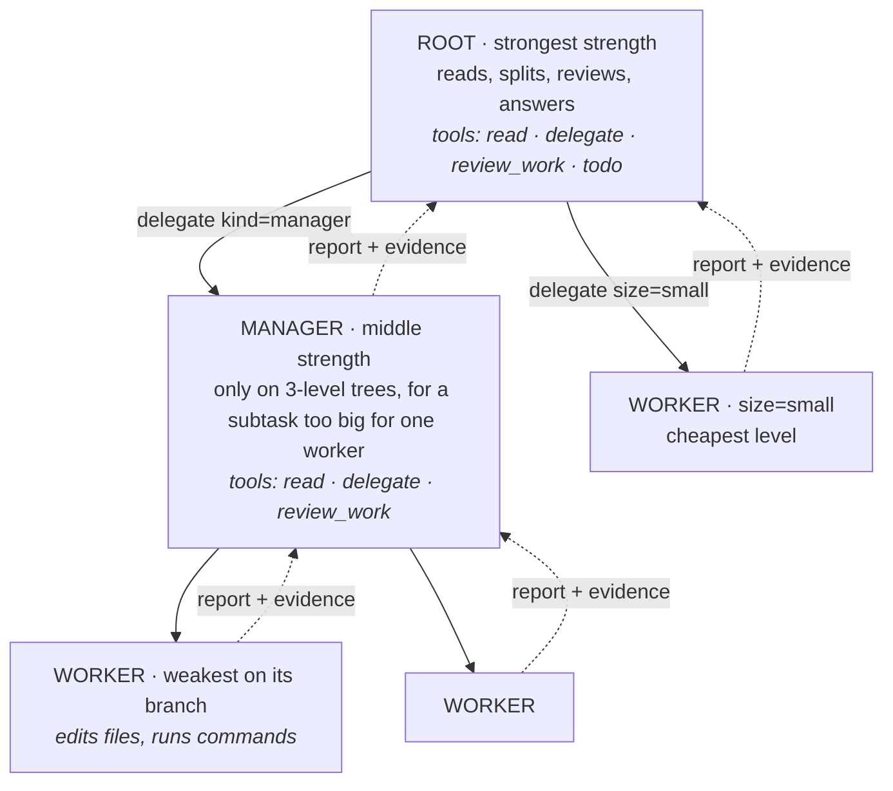

- **Levels come from your models.** The engine lists the strengths (strong, standard, light) among enabled models that
  can call tools, strongest first. One strength means a 1-level tree: the root works alone.
- **Roles are enforced by tools, not prompts.** Parents only get read tools plus `delegate` and `review_work`, so they
  have no way to edit a file or run a command. Only workers change things.
- **Easy work stays cheap.** The root gives a simple task to one worker with `size="small"` on the cheapest level,
  instead of doing it on the expensive model.
- **Review on evidence.** When a child reports, the parent also gets what the engine **saw** it do: files written, and
  commands with their exit codes and last lines, cut to 4,000 characters. A child cannot claim tests pass that never
  ran.
- **Retry ladder.** After a reject, the same child gets one more try with the feedback. Then the next stronger model
  takes over the same conversation for one try. After that the subtask counts as failed, and the final answer ends with
  a **Not finished** list.
- **Nothing skips review.** A parent that tries to finish with unreviewed children is reminded up to twice. After that,
  the work is marked *not reviewed* and stays visible.
- **Guards.** At most 12 agents below the root, and at most 3 workers at once; parents waiting on children hold no slot,
  so a level of managers cannot deadlock. A file written by two agents is flagged in both agents' evidence. Requests left on a
  shared quota are tracked, and with fewer than about 15 left the root works alone. Work already done is kept even if
  no model can write the final message.

### 8. Durability

Every stage's result, every agent transcript, and every tree node lives in the run's state, which is checkpointed. A
crash, a restart, a closed laptop lid, or an approval that takes a day resumes from the last checkpoint. Provider calls
are **at least once**: a crash during a request can send it again, so this is not an exactly-once billing guarantee.

## Tech stack

| Layer | Technology | Used for |
| --- | --- | --- |
| Language | **Python 3.11+** (3.12 in Docker), **TypeScript** | Engine, API, worker, CLI; browser scripts |
| API | **FastAPI**, **Uvicorn**, **Pydantic v2** | HTTP API, validated settings and inputs, OpenAPI docs at `/api/docs` |
| Persistence | **SQLAlchemy 2**, **SQLite** (WAL) locally, **PostgreSQL 17** via **psycopg 3** in Compose | Users, models, runs, events, the call ledger |
| HTTP and models | **httpx** (async, streaming) | OpenAI Chat Completions, OpenAI Responses, and Anthropic Messages, with tool calling |
| Security | **cryptography** (Fernet), **bcrypt** | Encrypted keys and tokens at rest; password hashes |
| Sign-in | OAuth 2.0 / OpenID Connect | Google, GitHub, any OIDC provider; device sign-in for the CLI |
| Frontend | **Astro 7**, TypeScript, plain DOM, **IBM Plex Sans** | Static pages served by the API; no UI framework |
| Terminal | **Rich**, **prompt_toolkit**, **keyring** | L.E.O.C.O.D.E's interface, theme, and OS-keychain secrets |
| Distribution | **uv** (workspace), **hatchling**, an **npm** launcher | `uv tool install`, `npm i -g leo-orchestrator` |
| Tools | **SearXNG**, Wikimedia Commons API, **MCP** (Streamable HTTP client, stdio server) | Search, photos, connectors, integration with other agents |
| Containers | **Docker Compose**: API, worker, PostgreSQL, SearXNG, `sandboxd`, egress proxy, sandbox image; optional **gVisor** | Deployment and agent sandboxes |
| Subscription models | **[9Router](https://github.com/decolua/9router)**, one container per user | ChatGPT (Codex), Copilot, Kiro, Kimi, and other account sign-ins |
| Tests | **pytest**, **pytest-asyncio**, `httpx.MockTransport`, a mock provider and a mock MCP server | 396 tests that never call real providers, plus 9 that need a running `sandboxd` |

## Screenshots

All screenshots were taken on 7 November 2026 from the current code. The web screenshots show real data from a QA
workspace; the terminal screenshots are described one by one.

| Reviewed coding answer | Per-chat usage |
| --- | --- |
| 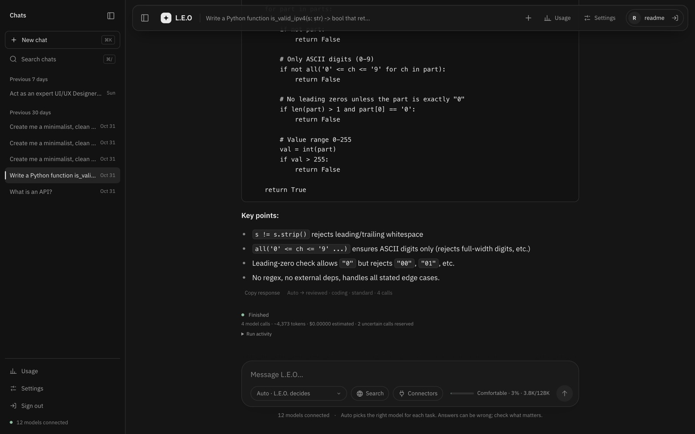 | 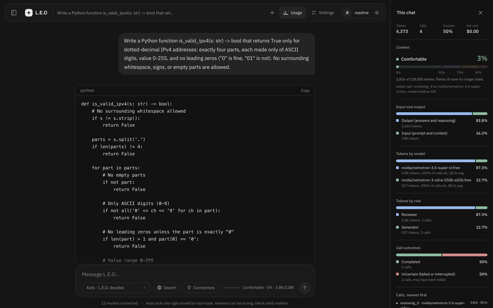 |
| HEAD chose `Auto → reviewed · coding · standard`. Two free models failed at once, Nemotron 3 Ultra wrote the code (557 tokens), and Nemotron 3.5 Super VL reviewed it (3,816 tokens). *(Real run)* | Context level, tokens by model and by role, and call outcomes. The two failed calls show as *uncertain*: their reservation still counts. *(Real data)* |
| **Usage across all chats** | **Settings → Models** |
| 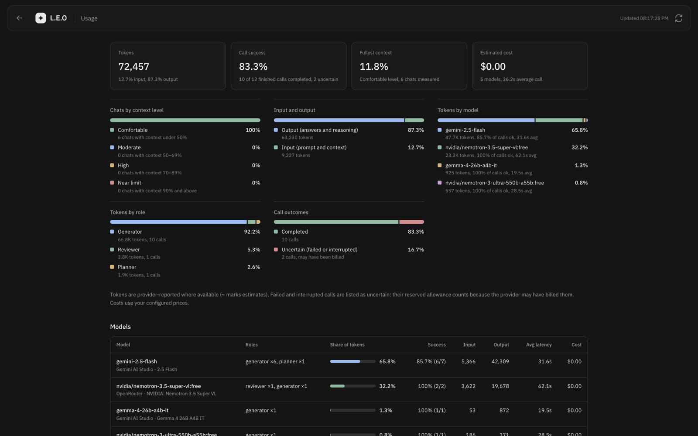 | 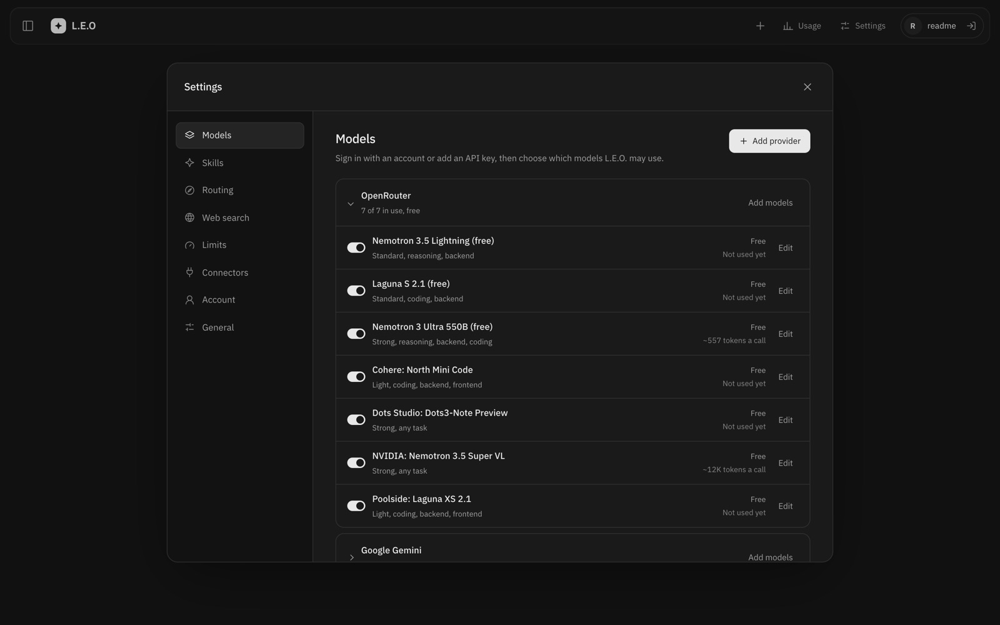 |
| Tokens, success rate, fullest context, and cost; shares by model, role, and outcome. *(Real data)* | One row per provider. Each model has a switch, a strength, skills, a price, and its average tokens per call. *(Real data)* |
| **Settings → Routing** | **The benchmark pages, side by side** |
| 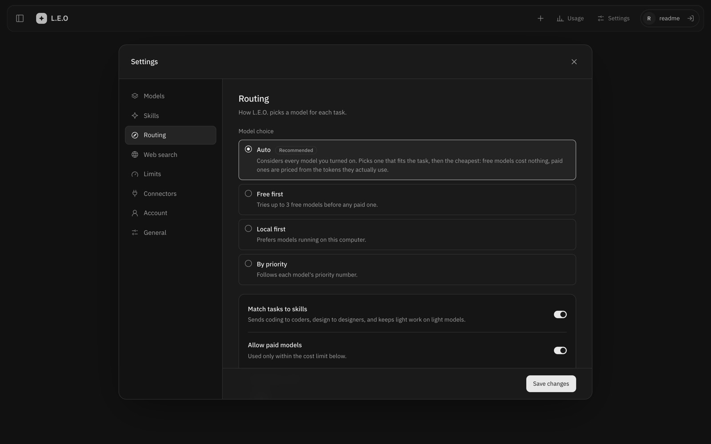 | 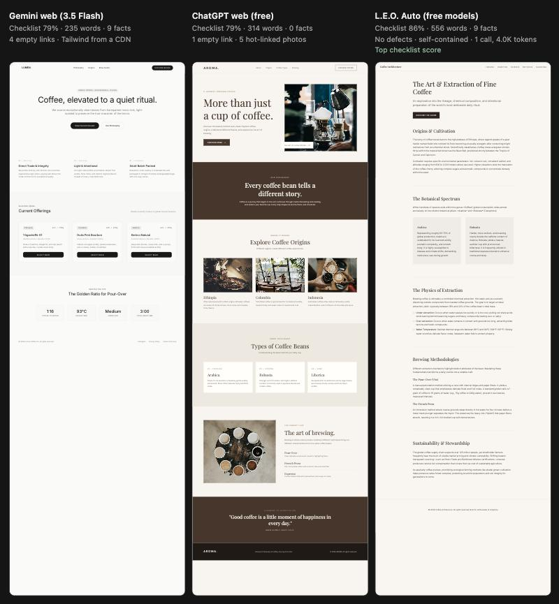 |
| **Auto** weighs every model you turned on: fit first, then cost per call. | See [Benchmarks](#benchmarks). |

### L.E.O.C.O.D.E in the terminal

| Welcome | The tree at work |
| --- | --- |
|  | 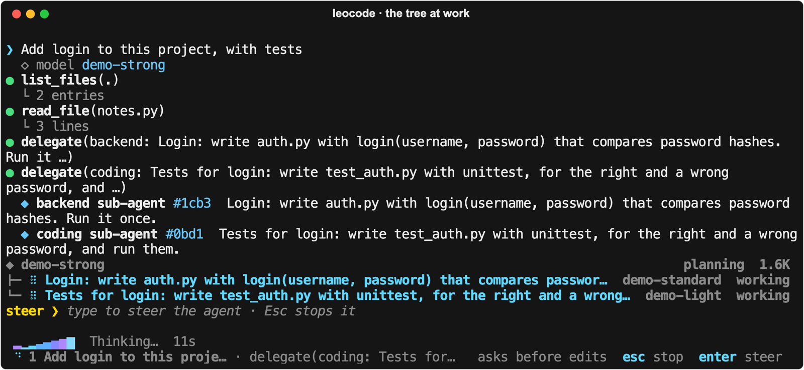 |
| **Approval before a change** | **Done: answer and tree** |
| 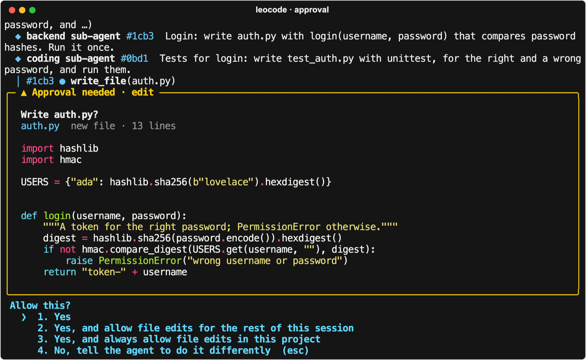 | 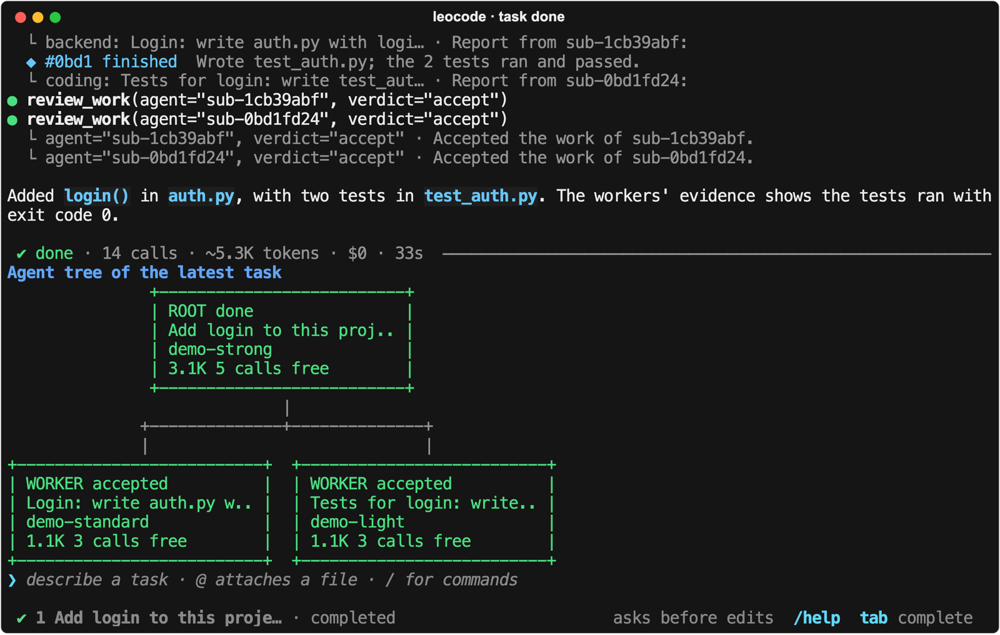 |

<sub>The real `leocode` in a terminal, on a demo project, with **scripted local models** (`demo-strong`,
`demo-standard`, `demo-light`) so the run is repeatable and costs nothing. The scripts only decide what each model
asks for. Everything else is real: the engine, the tree, the approvals, the files written, and the test run (`Ran 2
tests … OK`).</sub>

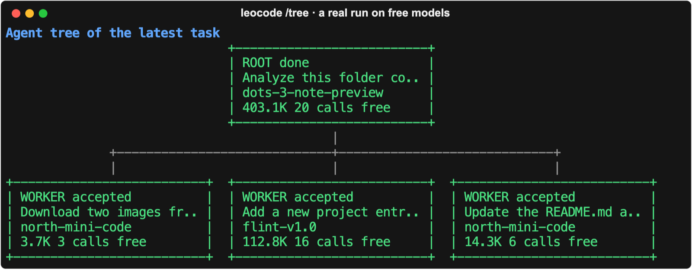

<sub>`/tree` of a **real** 4-agent run on free OpenRouter models: the root (Dots3-Note) split the task between three
workers on two strengths and accepted all three. 50 calls, 542K tokens, $0. The root alone used 403K of those tokens,
so the tree's cost goal is not met yet (see [Status](#status)). *(Real run)*</sub>

## Benchmarks

### Against the Gemini and ChatGPT web apps

The same prompts went to **gemini.google.com** (Gemini 3.5 Flash), **chatgpt.com** (free, logged out), and L.E.O. Auto
with its free models. [`benchmarks/qa.py`](benchmarks/qa.py) graded every reply the same way: hidden tests for code,
the known answer for the puzzle, and for the page a 14-point checklist, visitor-facing defects, and content measured in
the browser.

| Task | Gemini web | ChatGPT web | L.E.O. (free models) | L.E.O. calls · tokens · time |
| --- | :---: | :---: | :---: | --- |
| IPv4 validator (hidden tests) | ✅ | ✅ | ✅ | 2 · 8.3K · 107 s |
| Duration parser (hidden tests) | ✅ | ✅ | ✅ | 3 · 17.7K · 161 s |
| Roman numerals (hidden tests) | ✅ | ✅ | ✅ | 2 · 7.5K · 54 s |
| Stairs puzzle (answer 927) | ✅ | ✅ | ✅ | 1 · 1.7K · 38 s |
| Coffee landing page: checklist | 79% | 79% | **79–93%** (4 runs) | 1 · 4.0–9.2K · 10–38 s |
| … broken or empty links | 4 | 1 | **0** | |
| … photos | none | 5 hot-linked | **3 verified, credited** | |
| … external scripts | Tailwind CDN | none | **none** | |

In round 1, L.E.O. passed only 1 of 4. A cheap coding model used `str.isdigit()` (which accepts non-ASCII digits) and
left a broken draft before a "let me revise" version, and the page was thin with a broken link. Each fix in the
[harness](#the-harness-algorithm) came from that QA loop: the independent reviewer where rules are stated, static checks
that trigger a repair, verified photos, self-correcting reasoning profiles, and continuation of cut-off answers.
ChatGPT's page is the most polished visually; L.E.O.'s has real, credited photos, the most content, and no broken links.
Claude.ai needs a sign-in, so Claude is not in this table yet.

<details>
<summary><b>Earlier benchmarks, and how to run them</b></summary>

[`benchmarks/run.py`](benchmarks/run.py) sends the same prompts to single models directly ("one app, one model") and
to L.E.O. It checks coding answers against hidden acceptance tests (run in a macOS sandbox with network and writes
blocked), scores websites with a 14-point rubric, and checks the long app task for its required features.
[`benchmarks/report.py`](benchmarks/report.py) merges result files and recomputes L.E.O.'s **actual** tokens from each
run's call ledger.

```bash
LEO_DATA_DIR=.leo-bench uv run python -m benchmarks.run --single gemini-3.5-flash --single <other model> --leo auto
uv run python -m benchmarks.report benchmarks/results/<file>.json [...]
```

**30 Oct 2026: L.E.O. Auto with a team of free models.** Team: Gemini 2.5 Flash, Laguna S (coding), Nemotron 3.5
Lightning (reasoning), and Nemotron 3 Ultra 550B (strong). Thinking tokens are counted.

| Approach | Correct | Blocked by provider | Tokens per correct task | Mean time |
| --- | --- | --- | --- | --- |
| Gemini 3.5 Flash alone | 2/2 | 7 of 9 (free quota exhausted) | 2,746 | 17 s |
| **L.E.O. Auto** | **8/9** | **0** | 14,822 | 116 s |
| Nemotron 3 Ultra alone (pages and app only) | 2/3 | 0 | 20,143 | 347 s |

- **Everyday coding:** L.E.O. used fewer tokens than Gemini 3.5 Flash alone on every task both answered (−48% and −22%).
- **Resilience:** L.E.O. answered every task, while the single free model hit its quota after two.
- **Builds:** L.E.O. cost 2–4× the tokens of one strong model; two fixes since then target this, and a re-run is pending.
- **Shared limits:** most models, L.E.O.'s included, failed the IPv4 edge case. Routing cannot add knowledge the models lack.

**29 Oct 2026, before smart routing:** a fixed generator, uncounted thinking tokens, and a context bug in Deep mode,
all fixed in the next version. Full results are in [`benchmarks/results/`](benchmarks/results). Samples are small;
treat differences as indicative.

**Agent benchmark.** [`benchmarks/agent.py`](benchmarks/agent.py) runs three tasks end to end with hidden tests: build
a todo app, fix a project's failing tests, and add authentication to an API (50+ steps, research and testing
sub-agents, and a worker restart in the middle).

</details>

## Status

**Working and tested** (396 passing tests, plus browser and terminal checks): HEAD and every pipeline; OpenRouter
and Gemini AI Studio live; web research; verified photos; durable runs and recovery; limits and paid opt-in; accounts
with password, Google, GitHub, and OIDC sign-in; connectors with OAuth; the sandboxed agent mode; L.E.O.C.O.D.E with
its tree of agents; the MCP server.

**Not yet proven:**

- **The tree's cost goal.** The aim is that a tree of mostly free models matches one strong model with fewer
  strong-model tokens. It is not measured yet. In the first real runs (6 November 2026) the root often worked alone.
  In the 4-agent run above, made after the fixes from that QA, the root still used 74% of the tokens: 397K input
  over 20 calls, because it re-sends its growing context each time, against 6K output. A benchmark against the flat
  agent is pending.
- **Speed on code.** Reviewed answers take 1–3 minutes; the web apps answer in seconds.
- **Free-tier limits dominate.** OpenRouter's free tier allows 50 requests a day per key across all free models. L.E.O.
  tracks the limit and skips those models until it resets, but a large tree needs more.
- **Review in Chat is a model's opinion.** The server never runs generated code. Only L.E.O.C.O.D.E's workers run
  tests, and their parents review that evidence.
- **Less tested:** live use of OpenAI, Qwen, OpenCode, Ollama, LM Studio, vLLM, and Claude generation; schema
  migrations (there are none yet).

## Security

- **Accounts and access.** Registration is off by default: only the first local user, or an admin, can create accounts
  (`LEO_ALLOW_REGISTRATION`). `LEO_ALLOWED_EMAILS` limits OAuth sign-in. `LEO_API_TOKEN` is an admin token for scripts.
  The API refuses to start when `LEO_ALLOWED_HOSTS` names a non-loopback host and no token is set. For remote access,
  set exact `LEO_ALLOWED_ORIGINS` and `LEO_ALLOWED_HOSTS` and put HTTPS in front.
- **Keys.** Provider keys, connector tokens, and router passwords are encrypted at rest (Fernet) and never returned by
  the API. Back up the database **and** `.leo/secret.key` (or `LEO_ENCRYPTION_KEY`) together. The CLI keeps its secrets
  in the OS keychain.
- **Untrusted content.** Web pages, search results, photo titles, MCP results, and model output are passed to models as
  data, never as instructions. Pages are fetched only from public addresses, including after redirects.
- **Generated code.** In Chat the server only parses Python and JSON. A generated page runs in a sandboxed frame without
  same-origin access, with a content security policy that blocks network requests. Messages render model output as
  text, never as HTML.
- **Agent sandboxes (server).** One container per workspace, non-root, every capability dropped, `no-new-privileges`,
  CPU, memory, and process limits, on an internal network whose only exit is an egress proxy for package registries.
  Git tokens stay outside the sandbox, and a push needs your approval. Set `LEO_SANDBOX_RUNTIME=runsc` for gVisor.
- **L.E.O.C.O.D.E (your machine).** There is no sandbox: the agent works as you. Paths are confined to the project,
  edits and commands ask first, and `sudo`, `rm -rf /` or `~`, `curl | sh`, `git push`, and skill installs always ask,
  even with `--autorun`.

## Reference

<details>
<summary><b>Accounts and sign-in</b></summary>

The sign-in page offers **Continue with Google**, **GitHub**, or any OpenID Connect provider (Keycloak, Authentik,
Microsoft Entra, Auth0, ...), plus username and password. A provider's button appears once its client ID and secret are
in `.env` (see `.env.example`). Register this callback URL with each provider:
`<LEO_PUBLIC_URL>/api/auth/oauth/<google|github|oidc>/callback`.

- **Who may join:** `LEO_ALLOWED_EMAILS` lists exact emails and `@domain` entries, checked on every OAuth sign-in. Left
  empty, OAuth signs in existing accounts and creates only the very first one.
- **Same person, several providers:** a verified email that matches an existing account lands on that account.
- **Settings → Account:** link or unlink providers, set or change a password, manage model accounts, and sign out lost
  CLI devices. You cannot unlink your last way to sign in.

</details>

<details>
<summary><b>Connect models</b></summary>

**Sign in with an account (Docker Compose).** **Settings → Add provider** offers one-click sign-in: ChatGPT (Codex),
GitHub Copilot, Kiro, Kimi, Kilo Code, Qoder, Grok CLI, and Z.ai GLM Coding. Behind it, each user gets their own
[9Router](https://github.com/decolua/9router) container (pinned, no host port), which keeps and refreshes the tokens
and serves the models. Routers are per user because a 9Router key reaches every account signed in on that router.
9Router warns that ChatGPT (Codex), GitHub Copilot, and Kiro do not license subscription sign-in for router use and may
restrict such accounts; L.E.O. asks you to accept that first. Claude subscription sign-in is not offered (Anthropic
only allows those tokens in its own apps), so use a Claude API key.

**Or use an API key:** **Settings → Add provider → Use an API key instead**, choose a preset, set the base URL and
model ID, and paste the key (encrypted, never shown again). Set the routing profile (skills, strength, and
**Reasoning model** if it thinks before answering). **Check** tests the catalog without a generation request. For a paid
model, enter prices per million tokens and enable **Allow paid API usage**.

| Provider | Preset / protocol | Suggested profile |
| --- | --- | --- |
| Ollama | `http://localhost:11434/v1`, Chat Completions | General · light |
| vLLM / LM Studio | Your server URL (LM Studio is usually port 1234) | General · standard |
| 9Router | Managed per user by Compose; outside Docker `http://localhost:20128/v1` | Set per model |
| OpenRouter | `https://openrouter.ai/api/v1` | Set per model |
| OpenAI / GPT | `https://api.openai.com/v1`; Responses | Coding, Backend, Reasoning · strong |
| Anthropic / Claude | `https://api.anthropic.com/v1`; Anthropic Messages | Coding, Backend, Frontend, Reasoning · strong |
| Qwen / Alibaba Cloud | DashScope OpenAI-compatible API | Coding, General · standard |
| OpenCode | OpenCode inference API | Coding · standard |
| Google Gemini (AI Studio) | Gemini OpenAI-compatible API | Frontend, Design, General · standard |

A ChatGPT or Claude chat subscription is not API access; an API key uses API billing. **No API charge** means you have
verified the endpoint is free for this usage.

</details>

<details>
<summary><b>Discover models</b></summary>

**Add models** reads a provider's whole catalog and suggests a profile for each chat model: OpenRouter's free models,
Gemini's text chat models, Claude 4.5 and later, or whatever an OpenAI-compatible `/models` lists. Strength comes from
size and family (550B, Pro, Opus → strong; Mini, Haiku, small sizes → light). Thinking comes from what the provider
reports, and coding skills only from models the provider describes as coding models. **Check access first** sends one
tiny request per model and skips those your key cannot use, with the reason.

</details>

<details>
<summary><b>Skills</b></summary>

**Settings → Skills** manages what HEAD matches on. Each skill has a name, a description (shown to the Deep-mode
planner), keywords (whole words), instructions added to the prompt whenever a model works on it, and a switch. Seven
starter skills are created on first start: General, Frontend, Backend, Coding, Design, Research, and Reasoning. Edit,
disable, or delete them, or add your own, such as "Data analysis" with `pandas, dataframe, chart`. A model with no skills is a **generalist**: it
can take any task but loses ties to a specialist. Turn off **Match tasks to skills** to go back to fixed roles.

</details>

<details>
<summary><b>Web research and photos</b></summary>

- **Simple research:** L.E.O. searches your SearXNG with your words, reads the top pages (3 by default, about 8,000
  characters each), and one model answers citing them as [n]. The search costs no model tokens.
- **Deep runs:** the planner can give a task its own search with up to three queries; only that task gets the text.
- **The 🌐 Search toggle** forces research for one message.
- **Photos for pages:** for a page build, L.E.O. searches Wikimedia Commons for the page's topic. It keeps JPEG photos
  at least 1,000 px wide, landscape, under a CC or public-domain licence, from Wikimedia's own host, that load when
  checked. Up to four go to the model with their author and licence; it must credit what it uses and may not invent
  other image URLs.

SearXNG needs JSON output (`deploy/searxng/settings.yml`). `./start.sh` starts it from `<workspace>/searxng` when
installed there, or uses one on port 8888; with Docker, `docker compose up searxng`. Then set **Settings → Web search**
to `http://localhost:8888` and click **Test search**.

</details>

<details>
<summary><b>Limits and defaults</b></summary>

| Setting | Chat runs | Agent runs |
| --- | --- | --- |
| Model calls | 8 | 200 |
| Tokens | 200,000 | 4,000,000 |
| Estimated cost | $0.10 | $1.00 |
| Time | 10 min | 2 h (from the last approval) |
| Repairs | 1 | — |
| Steps | — | 80 (lead), 40 (sub-agent) |
| Sub-agents at once | — | 3 |

Every call counts, including planning, review, repair, and failed attempts. Context is capped at 64,000 tokens and
output at 8,192 per call by default (Settings → Limits). Agent runs that reach a limit ask for another allowance of the
same size instead of failing.

</details>

<details>
<summary><b>Canvas, usage, and context</b></summary>

- **Canvas:** an HTML answer streams into the canvas while it is written, then runs as a live preview with **Preview /
  Code**, **Desktop width** (1,400 px), **Run again**, **Open in a new tab**, and **Download**.
- **Context meter** next to the message box, e.g. `Comfortable · 3% · 3.8K/128K`. Levels: Comfortable under 50%,
  Moderate 50–69%, High 70–89%, Near limit 90% and above (older turns are being trimmed).
- **Per-chat Usage panel** and the **Usage page** (`/usage/`): tokens, success rate, cost, and shares by model, role,
  and outcome, with every call and its model.

</details>

<details>
<summary><b>Use L.E.O. from Claude Code (MCP)</b></summary>

```bash
claude mcp add leo -- uv run --directory /path/to/L.E.O python -m backend.mcp_server
```

| Tool | What it does |
| --- | --- |
| `leo_ask` | Send a request (mode `auto` by default); returns the answer, the route, the models per stage, usage, and a `conversation_id` to continue |
| `leo_route` | Preview the routing decision without calling a model |
| `leo_usage` | Tokens, calls, cost, and context per model, overall or for one conversation |
| `leo_models` | List connections with their skills, tier, and reasoning flag |

Set `LEO_API_URL` if the API is not at `http://127.0.0.1:8000`, and `LEO_API_TOKEN` when the server requires a token.

</details>

<details>
<summary><b>Connectors (remote MCP servers in Chat)</b></summary>

1. **Settings → Connectors:** add an MCP server by URL (Streamable HTTP), then sign in (OAuth with automatic client
   registration) or paste a token.
2. **Per chat:** the composer's **Connectors** menu chooses which ones a chat may use.
3. **Who calls tools:** only the sub-agent writing the answer, or in Deep mode the tasks the planner assigned a connector
   to. Planner and reviewer never call tools.
4. **Permissions:** every tool starts at **Ask** (Allow once, Always allow, Deny). A resumed run never calls a tool
   twice.
5. **Addresses** must be public HTTPS unless `LEO_MCP_ALLOW_PRIVATE=1`.

</details>

<details>
<summary><b>Agent mode on the server</b></summary>

Agent work has moved to L.E.O.C.O.D.E, so the web app hides it unless the server sets `LEO_SERVER_AGENT=1` (with
Docker Compose). Then **Agent** in the composer gives the chat a Linux sandbox: start empty, upload a `.zip`, or clone a
repository. Browse files in the **Files** panel, download a `.zip`, and approve every `git_push`. The server's agent is
flat (a lead agent with sub-agents); the tree is used by L.E.O.C.O.D.E.

</details>

<details>
<summary><b>Run the processes separately, and Docker</b></summary>

```bash
uv run uvicorn backend.api:create_app --factory --host 127.0.0.1 --port 8000
uv run python -m backend.worker      # in another terminal, after the API has created the database
```

Both must use the same database and encryption key. Compose runs the API, the worker, PostgreSQL, SearXNG, `sandboxd`,
and the egress proxy, with ports bound to loopback (8000 for L.E.O., 8888 for SearXNG, 1455 for the ChatGPT sign-in
redirect). In **Settings → Web search** use `http://searxng:8080`, and reach host Ollama at
`http://host.docker.internal:11434/v1`. Every setting is documented in [`.env.example`](.env.example).

</details>

## Development

```bash
make check     # backend and CLI tests, plus the frontend type check
make build     # build the frontend the API serves
```

The test suites cover routing and ranking, every pipeline, fallback and cooldown, shared quotas, budgets and paid
opt-in, recovery from checkpoints, cancellation, context trimming, review and repair, accounts and OAuth, connectors,
the sandbox, the MCP server, the CLI, and the tree of agents with scripted models per strength. They use deterministic
HTTP transports and never call real providers.

For manual checks without real models, run the mock provider and connect it with model `leo-test-model`:

```bash
uv run uvicorn tests.mock_provider:app --host 127.0.0.1 --port 9011
```

Interactive API docs are at `/api/docs` while the backend runs. Requirements and design records live in
[`spec-driven.md`](spec-driven.md) and [`docs/superpowers/`](docs/superpowers).

## Roadmap

- Benchmark the tree of agents against the flat agent on real models, and cut the root's share of tokens.
- Run the same QA loop against Claude (claude.ai) and on more task types: apps, research, writing.
- Faster reviewed answers: a cheaper first review, and no review when static checks and the generator agree.
- Run acceptance tests in an isolated service, so Chat's reviews can rely on real tests.
- Learn routing from results: tune skills, tiers, effort, and Auto thresholds from benchmark outcomes.
- Database migrations before any shared hosting.

---

<sub>L.E.O. is a work in progress; issues and suggestions are welcome. No license has been chosen yet, so all rights are
reserved by the author until one is added. The banner is drawn from L.E.O.'s block-letter logo; the logo alone is in
[`docs/assets/`](docs/assets) as SVG.</sub>
