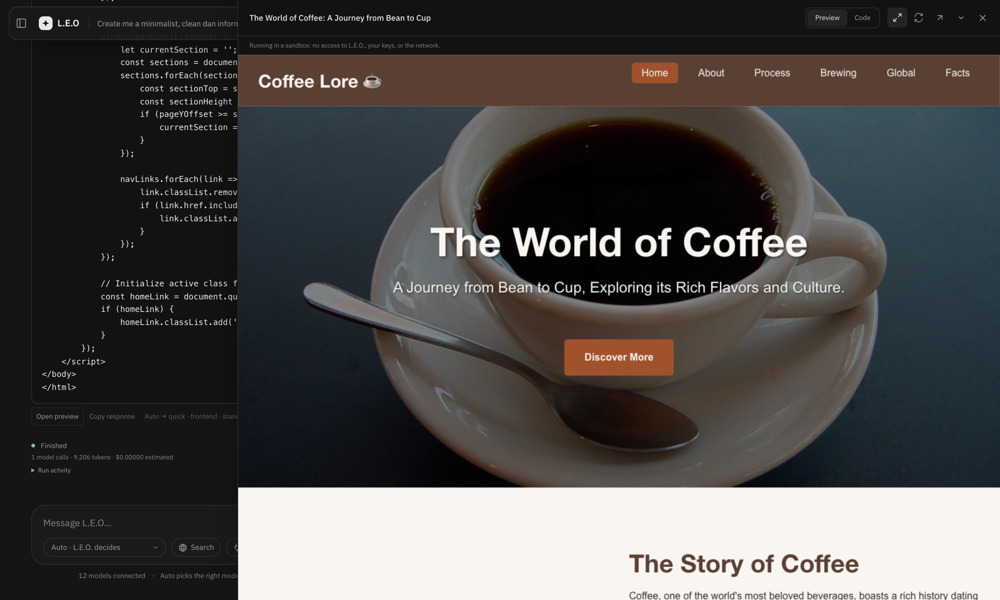
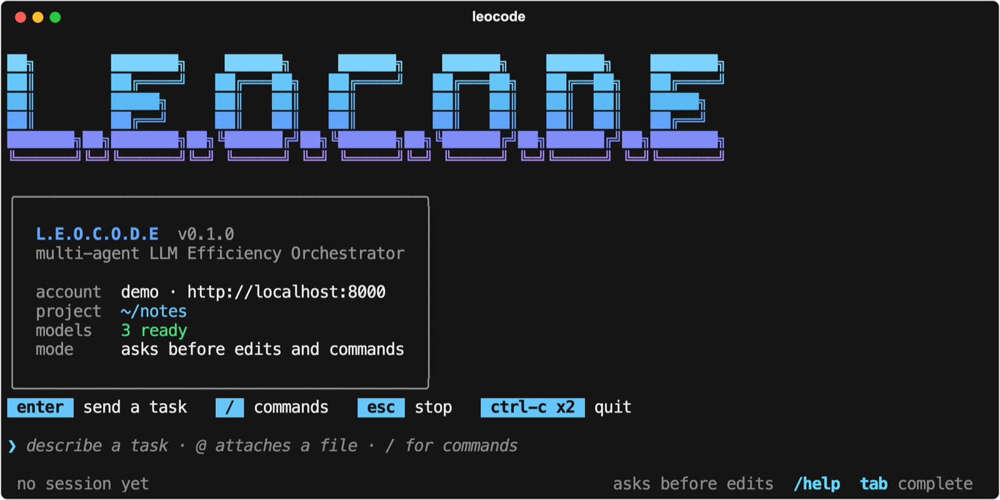
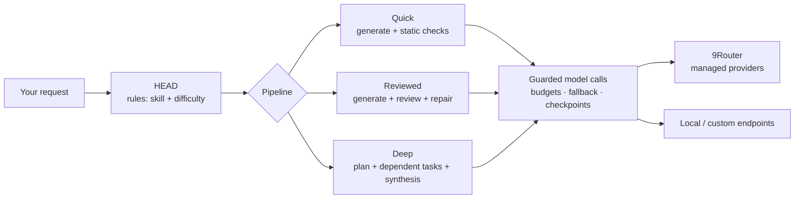
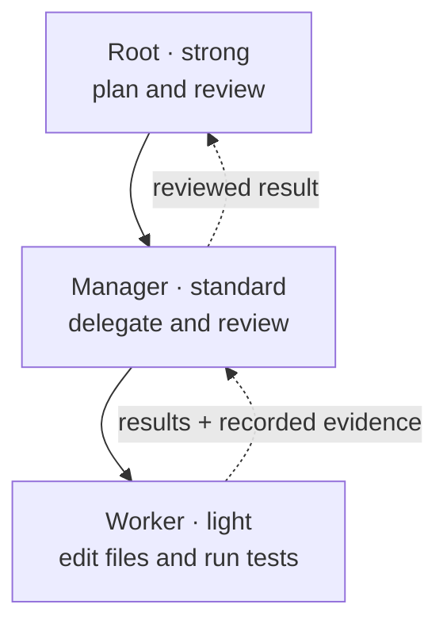

<div align="center">

# L.E.O.

**LLM Efficiency Orchestrator**

### Your models. One place to think, build, and code.

Connect your accounts, API providers, and local models.
Let L.E.O. route the work, track usage, and coordinate agents.


[Get started](#get-started) · [Connect models](#connect-models) · [CLI](#leocode) · [How it works](#how-it-works) · [Verification](#verification) · [Docs](#documentation)



<sub>Chat, route across models, and preview what you build. Captured from a real QA run.</sub>

</div>

L.E.O. brings your available models into one workspace. Use **Chat** for questions, research, and page previews;
use **L.E.O.C.O.D.E** for coding in your terminal. Both share routing, fallback, budgets, and a per-call usage ledger.
[9Router](https://github.com/decolua/9router) manages supported provider connections; L.E.O. handles task orchestration.

| Chat | Code | Inspect |
| --- | --- | --- |
| Auto routing, web research with citations, and a live HTML preview. | Local files, commands, tests, approvals, and a tree of agents. | See the chosen models, call outcomes, token usage, and estimated cost. |

> [!NOTE]
> **Experimental software.** The core paths have live verification, with known routing defects tracked below.
> Model quality, free-tier availability, and cost savings depend on your providers and workload. Database migrations
> are not available yet.

## Get started

### Docker Compose — managed model connections

Use this setup for provider API keys, account sign-ins through 9Router, and optional server sandboxes.
You need Docker with Compose. Run these commands from a checkout of this repository:

```bash
cp .env.example .env
# Edit .env and replace LEO_DB_PASSWORD with a strong password.
docker compose up --build -d
```

Open **[localhost:8000](http://localhost:8000)**, create your L.E.O. account, then connect a provider in
**Settings → Models**. You choose your L.E.O. password during account creation; there is no shared login password.
The database password in `.env` is separate.

```bash
docker compose ps                    # inspect service status
docker compose logs --tail=100 api worker sandboxd
docker compose down                  # stop the stack
```

Compose provides the API, background worker, PostgreSQL, SearXNG, and sandbox service. Each user's 9Router is
created on demand. Persistent data uses Docker volumes; see [configuration and backups](docs/configuration.md).

<details>
<summary><strong>Run from source — local or custom model endpoints</strong></summary>

You need Python 3.11+, [uv](https://docs.astral.sh/uv/), and Node.js 22.23.4+ (Node 24 recommended).

```bash
./start.sh
```

The launcher installs dependencies on first use, builds the frontend, starts the API and worker, and opens
**http://127.0.0.1:8000**. Ctrl+C stops the processes. Accounts, encrypted keys, chats, and settings live in `.leo/`.
Use `./start.sh .leo-bench` for a separate data directory.

Choose **Settings → Models → Connect provider → Local or custom server** for Ollama, LM Studio, vLLM, or another
compatible endpoint. Managed provider setup through 9Router requires the Compose sandbox service.

Web search is optional: the launcher uses an existing SearXNG on port 8888, or starts it if installed in the workspace.
See [web search setup](docs/configuration.md#configuration-reference).

</details>

## Connect models

**Settings → Models → Connect provider** is the starting point for all connections.

| Connection | What you do | Where requests go |
| --- | --- | --- |
| **Sign in** | Choose a supported account and complete browser or device-code sign-in. | Your user's 9Router → provider |
| **API key** | Choose a provider, enter its key, then choose models from the catalog. | Your user's 9Router → provider |
| **Local or custom server** | Enter the endpoint and model ID; add a key if required. | Directly to that endpoint |

After connecting, use **Choose models** to enable the models L.E.O. may use. OpenRouter starts with **Free only**
selected. Use **Edit** to adjust a model's tier, skills, or price. Paid models also require
**Settings → Routing → Allow paid API usage**.

Supported account options include ChatGPT (Codex), GitHub Copilot, Kiro, Kimi, Kilo Code, Qoder, Grok CLI, and
Z.ai GLM Coding. API-key options include OpenRouter, Gemini, OpenAI, Anthropic, DeepSeek, Groq, Mistral, xAI, and Cohere.
Account availability and provider restrictions apply; see the [connection reference](docs/configuration.md#configuration-reference).

### Where is 9Router running?

In the managed Compose setup, **each user has a separate Docker container**, named `leo-router-<user-id>`.
It listens on port **20128 inside Docker**, on the `leo-routers` network. Its port is not published to your computer,
so `http://localhost:20128/dashboard` is not the managed router's dashboard URL.

```bash
docker ps --filter name=leo-router --format 'table {{.Names}}\t{{.Status}}\t{{.Ports}}'
# Replace USER_ID with the ID from the container name shown above:
docker logs --tail=100 leo-router-USER_ID
```

In Models settings, **Refresh** checks connectivity. Then send a short message and inspect **Usage** to verify that a
model request completed. A healthy router can still encounter an upstream rate limit or an expired provider sign-in.
If the router is unavailable, check Docker and `sandboxd` logs before reconnecting an account.

Existing direct providers can use **Move to 9Router** while preserving model settings and usage history. Local and
custom endpoints remain available. See [provider setup and credentials](docs/configuration.md).

## L.E.O.C.O.D.E

The same engine, working in your project folder. Sign in to your L.E.O. server, sync models, and describe a task.

```bash
uv tool install ./leo-cli
cd my-project
leocode
```

Or install the npm launcher with `npm install -g leo-orchestrator`.

```bash
leocode -p "Fix the failing tests"    # one task
leocode --worktree                   # a separate Git worktree
leocode resume                       # continue the last session
```



| Command | Purpose |
| --- | --- |
| `/models` · `/models add` | Inspect or connect models; filter with `/models <search>`. |
| `/tree` | Inspect delegation, roles, and task status. |
| `/usage` · `/cost` | See model usage and session cost. |
| `/context` | Inspect context usage. |
| `/theme` | Choose a theme, including terminal colors and monochrome. |
| `/help` | Find commands and keyboard controls. |

The CLI asks before edits and commands by default. It works with your local permissions; it is not a sandbox.
For 9Router models, requests pass through L.E.O. using the CLI device token, while upstream keys stay on the server.
Local/custom models and older direct connections use their configured endpoints. Transcripts stay on your computer;
usage totals sync to the server.

**[Read the CLI guide →](leo-cli/README.md)** for sign-in, approvals, `@file` attachments, skills, MCP, and shortcuts.

## How it works

### Route → execute → check



HEAD classifies requests without spending model tokens. The engine ranks eligible models using saved capabilities,
tier, skill, cost, and preferences, then tries alternatives when a request fails. You can inspect the route and usage.

**Deep mode** accepts one to three tasks with dependencies only on earlier tasks, forming a bounded directed acyclic
graph (DAG). Task classification and ranking are deterministic for a given configuration. Model-generated plans,
answers, and reviews are not. Model tiers are editable metadata heuristics, not benchmarked intelligence scores.

### TSATM — a tree for coding tasks

The CLI's tree-structural agentic task management separates coordination from execution:



Available model tiers determine tree depth; a single-tier setup can work alone. In a multi-level tree, parent roles
read, delegate, and review, while workers edit and run commands. Shared budgets, bounded retries, execution evidence,
and checkpoints constrain the run. The optional server/web agent uses a flat lead-and-subagent structure.

**[Explore the architecture and algorithms →](docs/architecture.md)**

## Verification

Latest recorded audit: **11 November 2026**.

| Area | Observed result |
| --- | --- |
| Automated suite | **422 passed**, 9 optional Docker sandbox tests skipped. |
| Live 9Router calls | Native tool calls passed for Codex, Grok, and three OpenRouter models. |
| Live TSATM | Root → manager → worker completed across three tiers; all 8 structural checks passed. |
| Generated code | 6 worker tests and 2 independent acceptance tests passed. |
| Failure cascade | Gemma was rate-limited; Nemotron took over and returned `QA_OK`. |
| Budget resume | Completed on call 15 after one extension, with no repeated worker calls. |

**Two policy defects remain:** a pinned reviewer can review its own answer, and an insufficient light specialist can
outrank a stronger fallback model. The audit reproduces both. The live tree used 92,389 tokens for a small task;
efficiency against a single strong model remains unproven.

[Full QA report](docs/qa/algorithm-verification-2026-11-11.md) ·
[Machine-readable evidence](docs/qa/algorithm-verification-2026-11-11.json) ·
[Historical benchmarks](docs/benchmarks.md)

## Project status

L.E.O. is under active development. Chat, the CLI, managed model connections, research, usage tracking, and checkpoint
recovery have test coverage. Live verification is a sample of those flows, not a guarantee for every provider or task.

Current priorities:

- Enforce reviewer independence and correct insufficient-tier fallback ranking.
- Reconcile saved model profiles with discovery metadata and verified tool support.
- Benchmark TSATM against a flat agent and reduce coordination overhead.
- Add database migrations before shared deployments.

## Development

```bash
make install                         # Python dependencies + frontend build
make check                           # backend/CLI tests + frontend type check
make build                           # frontend production build
```

```bash
# Reproduce the routing policy audit; currently exits 1 for the two known defects.
uv run python -m benchmarks.algorithm_qa --output /tmp/leo-policy-qa
```

Regular tests use mocks and do not call live model providers. Optional network checks consume provider quota;
see the [QA reproduction guide](docs/qa/algorithm-verification-2026-11-11.md#reproduction-and-artifacts).
API documentation is available at `/api/docs` while the server is running.

## Documentation

| Guide | Contents |
| --- | --- |
| [CLI handbook](leo-cli/README.md) | Installation, sign-in, commands, approvals, skills, and MCP. |
| [Architecture and algorithms](docs/architecture.md) | HEAD, ranking, dependency plans, TSATM, durability, stack, and source map. |
| [Configuration and operations](docs/configuration.md) | Accounts, providers, search, limits, MCP, deployment, security, and backups. |
| [Algorithm QA](docs/qa/algorithm-verification-2026-11-11.md) | Live evidence, known defects, scope, and reproduction. |
| [Historical benchmarks](docs/benchmarks.md) | Previous comparisons, methodology, and benchmark commands. |
| [Screenshot gallery](docs/gallery.md) | Chat, settings, usage, and terminal examples with context. |
| [Product requirements](spec-driven.md) | Product scope and requirements. |

**Using L.E.O. with another agent?** The stdio MCP server provides `leo_ask`, `leo_route`, `leo_usage`, and `leo_models`.
See [MCP setup](docs/configuration.md#configuration-reference).

---

<sub>No license has been selected. All rights remain reserved by the author until a license is added.</sub>
