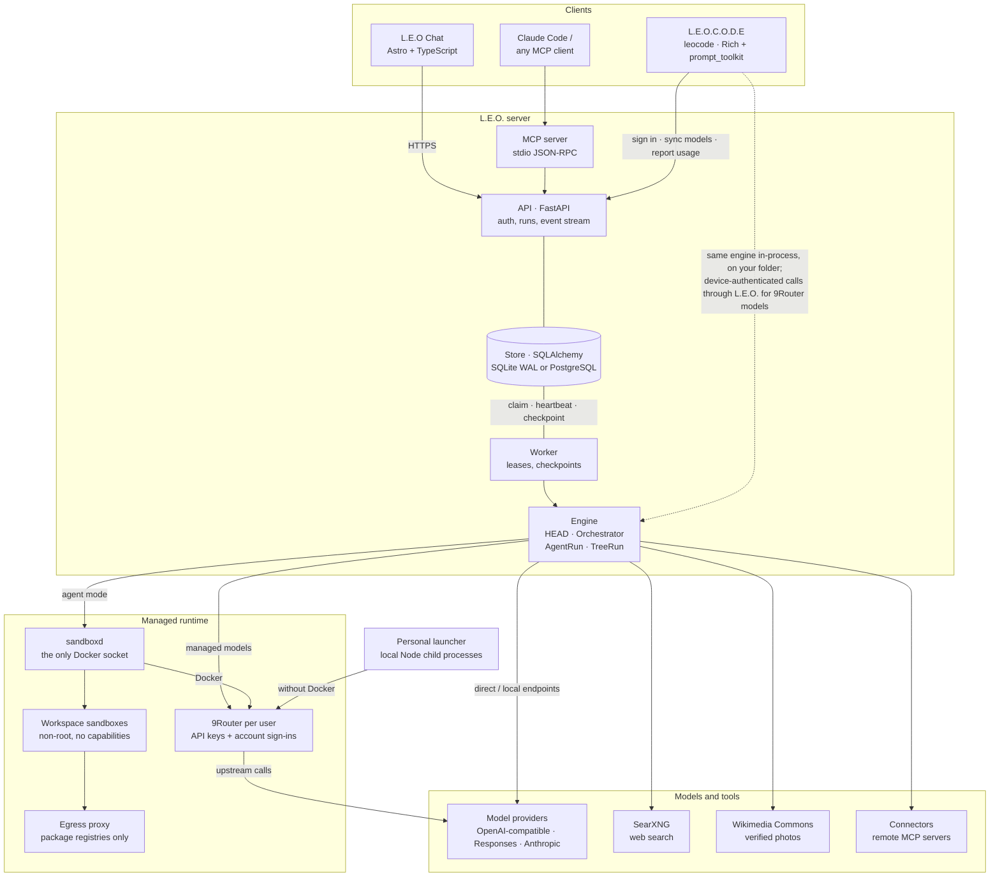
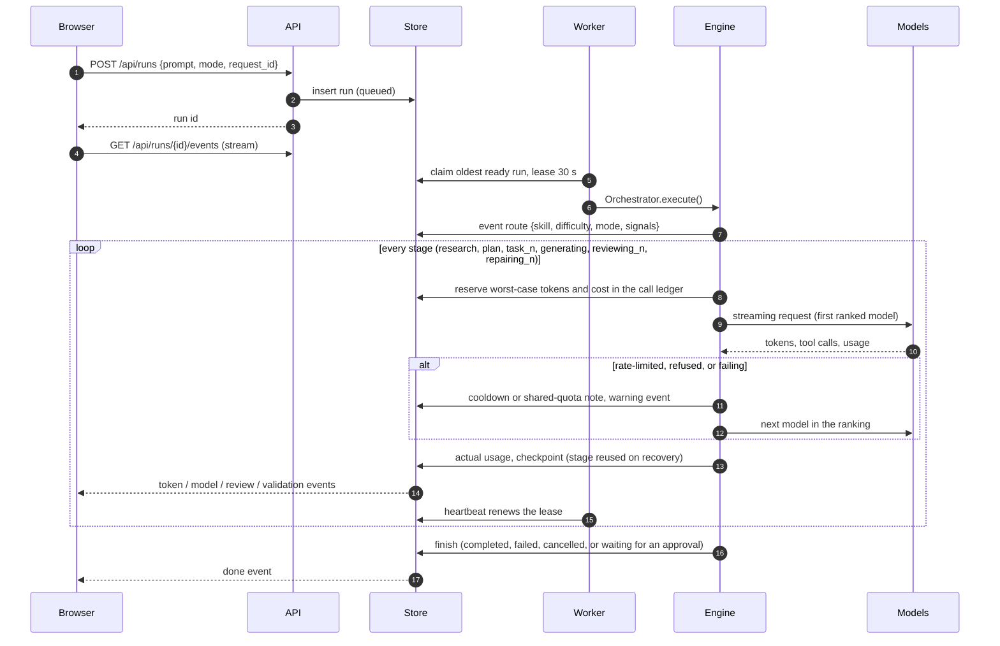
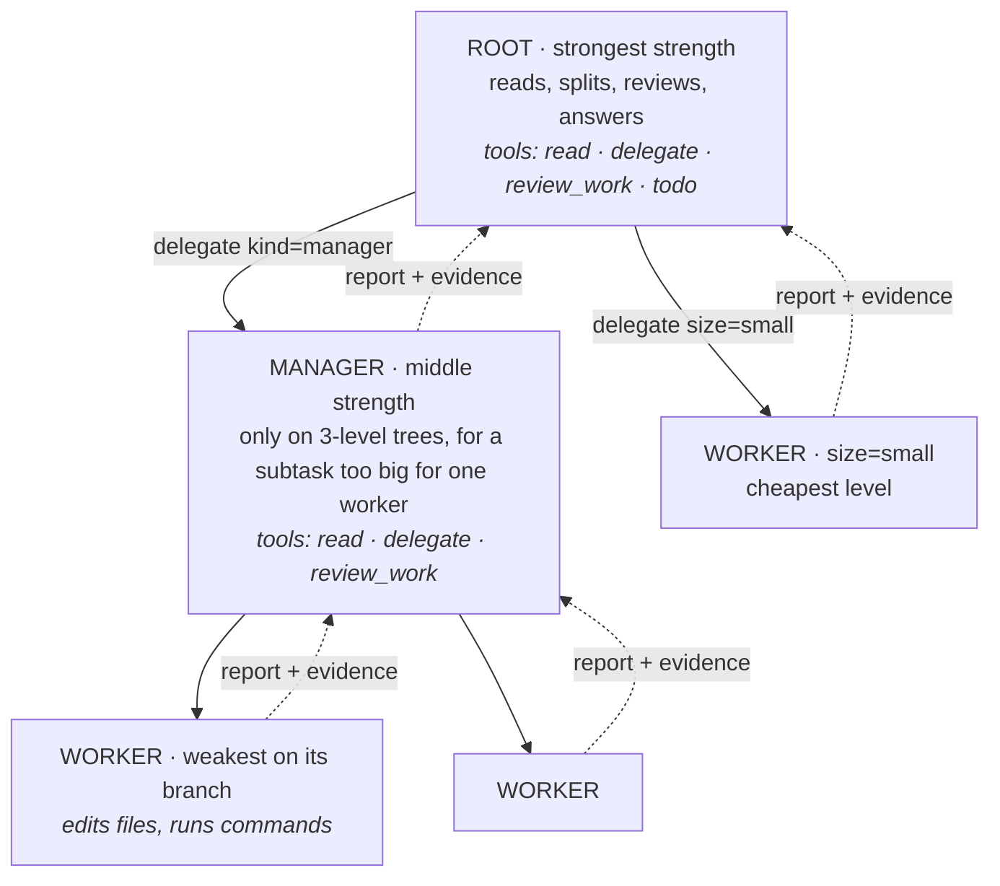

# Architecture and algorithms

[← Back to README](../README.md)

The shared engine combines rule-based routing, bounded dependency plans, and a hierarchical CLI agent.
Model strength labels are editable metadata heuristics, not measured intelligence scores. Routing order is deterministic
for a given configuration; model-generated plans and verdicts are not.

## Architecture



**How the pieces fit together**

- **Chat runs execute in the worker.** `POST /api/runs` stores a run as `queued` with an idempotency key and returns.
  CLI model requests for managed providers are proxied through the API to 9Router. The
  browser follows `GET /api/runs/{id}/events`, a resumable event stream: every event has an ID, so a reconnect replays
  what it missed. Closing the tab does not cancel a run; **Stop** does.
- **The worker owns execution.** It claims the oldest ready run with a 30-second lease and renews it every half second.
  It runs the engine and checkpoints the run's state after every stage. If a worker dies, another one reclaims the run
  once the lease expires, marks interrupted calls as such, reuses completed stages, and carries on.
- **The engine is one library.** HEAD (`router.py`), the orchestrator (`orchestrator.py`), the agent loop (`agent.py`),
  and the tree of agents (`tree.py`) know nothing about HTTP. The server runs them in the worker. L.E.O.C.O.D.E imports
  them in-process and swaps the Docker sandbox for `LocalWorkspace`, your folder, guarded by an approval policy.
- **Everything is in the store.** Users and sessions, model connections (keys Fernet-encrypted), skills, settings,
  conversations, runs with their state, events, and a per-call **ledger** (stage, model, reserved and actual tokens,
  cost, latency) that budgets, the Usage page, and `/usage` in the CLI are all computed from.

<details>
<summary><b>A run, step by step</b></summary>



</details>

<details>
<summary><b>Source map</b></summary>

| Path | Responsibility |
| --- | --- |
| [`backend/router.py`](../backend/router.py) | HEAD: starter skills, rule-based classification, search cues, Auto mode, effort, model ranking |
| [`backend/orchestrator.py`](../backend/orchestrator.py) | Model calls with fallback, budgets and reservations, rate limits and quotas, research, photos, Quick/Reviewed/Deep pipelines |
| [`backend/agent.py`](../backend/agent.py) | The agent loop: tools, parallel delegation, approvals, steering, context compaction |
| [`backend/tree.py`](../backend/tree.py) | The tree of agents for L.E.O.C.O.D.E: levels, delegation, evidence, review and retries |
| [`backend/context.py`](../backend/context.py) | Token bounds, context trimming, static checks, plan and review parsing |
| [`backend/providers.py`](../backend/providers.py) | Chat Completions, Responses, and Anthropic streaming adapters, tool-call assembly, error mapping |
| [`backend/chat_tools.py`](../backend/chat_tools.py), [`connectors.py`](../backend/connectors.py), [`mcp_client.py`](../backend/mcp_client.py), [`mcp_auth.py`](../backend/mcp_auth.py) | Connectors: remote MCP over Streamable HTTP, OAuth with PKCE and dynamic registration, per-tool permissions |
| [`backend/tools.py`](../backend/tools.py) | SearXNG search, safe page reading (public addresses only), Wikimedia photos |
| [`backend/discovery.py`](../backend/discovery.py), [`catalog.py`](../backend/catalog.py) | Model discovery and suggested routing profiles |
| [`backend/store.py`](../backend/store.py), [`schemas.py`](../backend/schemas.py) | Persistence, encryption, leases, the call ledger, usage reports; validated settings |
| [`backend/api.py`](../backend/api.py), [`auth.py`](../backend/auth.py), [`oauth.py`](../backend/oauth.py) | HTTP API, sessions, password and Google/GitHub/OIDC sign-in, CLI device sign-in |
| [`backend/worker.py`](../backend/worker.py), [`dev.py`](../backend/dev.py) | Durable worker; local launcher for API + worker |
| [`backend/sandbox.py`](../backend/sandbox.py), [`sandboxd.py`](../backend/sandboxd.py), [`egress.py`](../backend/egress.py) | Agent sandboxes: client, container daemon, egress allowlist proxy |
| [`backend/local_router.py`](../backend/local_router.py) | Personal runtime: loopback-only 9Router child processes, saved ports, lifecycle, and local data |
| [`backend/ninerouter.py`](../backend/ninerouter.py) | Per-user 9Router for API-key providers and subscription sign-ins (ChatGPT/Codex, Copilot, Kiro, …) |
| [`backend/mcp_server.py`](../backend/mcp_server.py) | L.E.O. as an MCP server |
| [`leo-cli/leo_cli/`](../leo-cli/leo_cli) | L.E.O.C.O.D.E: `app.py` (entry), `ui.py` (prompt and rendering), `sessions.py`, `workspace.py` (your folder), `policy.py` (approvals), `treeview.py`, `account.py` (sign-in and sync), `mcp.py`, `skills.py`, `mentions.py` |
| [`frontend/src/`](../frontend/src) | Astro pages; `scripts/chat.ts` (chat, settings, live run view), `markdown.ts` (safe rendering), `canvas.ts` (sandboxed preview), `usage*.ts` |
| [`benchmarks/`](../benchmarks) | Tasks with hidden tests, comparison runner, QA grader, results |
| [`tests/`](../tests), [`leo-cli/tests/`](../leo-cli/tests) | Test suites, a mock provider, and a mock MCP server |
| [`spec-driven.md`](../spec-driven.md), [`docs/superpowers/`](../docs/superpowers) | Product requirements and design records |

</details>

## The harness algorithm

The "harness" is everything between your message and the models: classifying the task, choosing a pipeline and a model,
calling it safely, checking the result, and, for agents, running the tool loop and the tree. The rest of this section
describes the code as it is in this repository.

### 1. HEAD classifies the task, with no tokens spent

[`classify()`](../backend/router.py) is pure rules over the text:

1. **Skill.** Each enabled skill has keywords, matched as whole words. The highest score wins, and ties go to a specific
   skill over General. If the request builds something (*build, create, make, develop, design, generate … app, page,
   API, game …*), the noun being built decides the skill. *"Create a landing page with a pricing table"* is Frontend,
   however often other keywords appear.
2. **Signals.** Single-page build, build request, scope words (*complete, production, secure, end-to-end, multi-page*),
   three or more skills involved, several parts (lists, *"and also"*, *"then"*), and a long request (over 1,200
   characters).
3. **Difficulty.**

   | Difficulty | When |
   | --- | --- |
   | **light** | A short question (*what, why, how does, explain, translate…*, at most 160 characters, no signals), or nothing that points higher |
   | **standard** | Any signal, a request over 280 characters, or a coding, backend, reasoning, or frontend task |
   | **strong** | A build request, two scope signals, or one scope signal across two skills |

4. **Checkable?** Two or more requirement words (*only, exactly, must, raise, invalid, edge case, at most…*) mean the
   answer can be checked against stated rules.
5. **Needs the web?** Explicit cues (*latest, news, price of, sources, cite, according to, weather…*) or a URL in the
   message. Plain questions are answered from model knowledge, because reading pages is the most expensive part of a
   run.

The decision is saved in the run's state and shown under the answer, for example
`Auto → reviewed · coding · standard · 4 calls`. `POST /api/route` and the MCP tool `leo_route` preview it for any
prompt without calling a model.

### 2. Auto picks a pipeline

| Pipeline | Chosen by Auto when | Calls |
| --- | --- | --- |
| **Quick** | Light and standard work, and a single self-contained page | 1 generation, local static checks, at most one repair if a check fails |
| **Reviewed** | Standard **checkable** coding, backend, or reasoning work; strong single-skill work | generation → static checks → a different model reviews → bounded repair and re-review |
| **Deep** | Strong work across two or more skills, or a build request | planner → 1–3 subtasks in dependency order, each routed by its own skill → synthesis → review where it pays |

Auto reviews only coding, backend, and reasoning. Reviews of design and prose mostly produce cosmetic notes and full
rewrites, so they cost more than they return.

### 3. Rank the models, then choose an effort

[`rank()`](../backend/router.py) sorts every enabled, eligible model by this key, in order:

1. **Strong enough** for the difficulty: sufficient models precede insufficient ones.
2. **Has the skill**, then generalist, then a specialist in something else.
3. With **Auto** routing: the **cheapest per call**. Free and local models cost 0. A paid model is priced from its own
   average tokens per call in the ledger (3,000 in / 1,500 out until it has history).
4. For light work, no hidden reasoning.
5. The **lightest tier that is enough**.
6. Then local first (Auto, Local first) or free first (Free first), then your priority number.

Planner, reviewer, and agent roles prioritize assigned models, then stronger tiers. The reviewer ordering penalizes
the answer's author, but does not exclude it. A pinned reviewer can therefore grade its own answer; fallback can also
reach the author. This is a known policy defect, documented in the [QA report](qa/algorithm-verification-2026-11-11.md).
Reasoning models get an effort by difficulty: `low` for light and standard work, `medium` for strong work and for page builds.

When no model meets the required tier, skill and cost still precede tier shortfall. This can select a light specialist
over a standard generalist and produce an inaccurate “strongest available” reason. See the
[reproduced case](qa/algorithm-verification-2026-11-11.md#reproduced-policy-failures).

### 4. Every call goes through one guarded loop

[`Orchestrator.call()`](../backend/orchestrator.py) is the only way the engine talks to a model:

```text
if this stage completed before (a resumed run):  return the saved result
queue = ranked candidates − disabled − cooling down − accounts at their shared limit
for model in queue:
    fit the context: keep system + request, drop the oldest whole turns that do not fit
    reserve: input bound (UTF-8 bytes / 3) + output cap; stop if calls, tokens, or cost would exceed the run's budget
    stream the response (text, tool calls, usage), publishing tokens as events
    on success: replace the reservation with provider-reported usage, checkpoint, return
    on failure:
        429 with a short wait (≤ 20 s) on the first choice  → wait once and retry it, rather than use a weaker model
        account-wide limit (e.g. OpenRouter free requests a day) → skip every model on that account until it resets
        retryable error  → cooldown of 30 s × 2^(failures − 1), up to an hour; try the next model
        no text but the output limit was hit → the model thinks; mark it as a reasoning model from now on
        tool definitions rejected → mark the model as unable to call tools
raise with a short list of why each model failed
```

Failed and interrupted calls **keep their reservation**, because the provider may have billed them. Paid models are
used only with **Allow paid API usage** on, within **Max cost per run**. With **Free first**, each step tries up to
three free models before a paid backup.

### 5. Check and repair

- **Static checks** ([`static_review()`](../backend/context.py)) parse Python with `ast` and JSON with `json`. They also
  flag several versions of one function, in-page links to ids that do not exist, and placeholder text. Regular Chat
  does not execute generated code; optional server agent mode runs it in a sandbox.
- **Review** requests a verdict in the form `{"passed": bool, "issues": [...]}`, subject to the reviewer-selection defect above. The prompt makes it
  list every stated requirement, trace the code by hand on the request's examples, and watch for look-alike checks
  (`str.isdigit()` accepts non-ASCII digits). An invalid verdict counts as **unverified, never as passed**, and failing
  static checks override a pass.
- **Repair** sends the issues back to the generator, up to `max_repairs` rounds (default 1).
- **Continuation.** An answer cut off inside a code block is continued from where it stopped, not regenerated.
- **Deep plans** are validated JSON: 1–3 tasks, dependencies only on earlier tasks (so no cycles), and skill labels
  checked against your skills. When the last task depends on every other one, its result is the answer and the
  synthesis rewrite is skipped.

### 6. The agent loop

[`AgentRun`](../backend/agent.py) runs *think → call tools → read results → repeat*. Each step goes through the same
`Orchestrator.call`, so it is routed, budgeted, and checkpointed:

- **Tools:** `bash`, `read_file`, `write_file`, `edit_file`, `list_files`, `read_url`, `web_search`, `todo_write`,
  `use_skill`, `delegate`, plus MCP tools from the workspace.
- **Parallel delegation.** A turn's ordinary tools run in order, then its `delegate` calls run concurrently (up to
  *Sub-agents at once*, default 3), each in its own context.
- **Approvals are checkpoints.** A question (an edit, a command, a push, a budget extension) raises `NeedsApproval`.
  The run is saved as `waiting` and resumes from the transcript once you answer, so nothing runs twice.
- **Steering.** Messages you send while it works are added to the lead agent's transcript.
- **Compaction.** At 60% of the context allowance, older steps are summarized by a light model. The task and recent
  steps are kept, and tool results stay with their calls.
- **Limits:** 80 steps for the lead agent (extendable on approval) and 40 for a sub-agent per attempt. The whole run
  shares one budget of calls, tokens, cost, and time.

### 7. The tree of agents (L.E.O.C.O.D.E)

The goal is that strong models judge while cheap models do the volume. [`TreeRun`](../backend/tree.py) grows the agent loop
into a tree:



- **Levels come from your models.** The engine lists the strengths (strong, standard, light) among enabled models that
  can call tools, strongest first. One strength means a 1-level tree: the root works alone.
- **Roles are enforced by tools, not prompts.** Parents only get read tools plus `delegate` and `review_work`, so they
  have no way to edit a file or run a command. Only workers change things.
- **Easy work stays cheap.** The root gives a simple task to one worker with `size="small"` on the cheapest level,
  instead of doing it on the expensive model.
- **Review on evidence.** When a child reports, the parent also gets what the engine **saw** it do: files written, and
  commands with their exit codes and last lines, cut to 4,000 characters. Parents can compare a child's claims against the recorded execution evidence.
- **Retry ladder.** After a reject, the same child gets one more try with the feedback. Then the next stronger model
  takes over the same conversation for one try. After that the subtask counts as failed, and the final answer ends with
  a **Not finished** list.
- **Nothing skips review.** A parent that tries to finish with unreviewed children is reminded up to twice. After that,
  the work is marked *not reviewed* and stays visible.
- **Guards.** At most 12 agents below the root, and at most 3 workers at once; parents waiting on children hold no slot,
  so a level of managers cannot deadlock. A file written by two agents is flagged in both agents' evidence. Requests left on a
  shared quota are tracked, and with fewer than about 15 left the root works alone. Work already done is kept even if
  no model can write the final message.

### 8. Durability

Every stage's result, every agent transcript, and every tree node lives in the run's state, which is checkpointed. Execution can resume from saved checkpoints after a crash, restart, or approval pause. Provider calls
are **at least once**: a crash during a request can send it again, so this is not an exactly-once billing guarantee.

## Tech stack

| Layer | Technology | Used for |
| --- | --- | --- |
| Language | **Python 3.11+** (3.12 in Docker), **TypeScript** | Engine, API, worker, CLI; browser scripts |
| API | **FastAPI**, **Uvicorn**, **Pydantic v2** | HTTP API, validated settings and inputs, OpenAPI docs at `/api/docs` |
| Persistence | **SQLAlchemy 2**, **SQLite** (WAL) locally, **PostgreSQL 17** via **psycopg 3** in Compose | Users, models, runs, events, the call ledger |
| HTTP and models | **httpx** (async, streaming) | OpenAI Chat Completions, OpenAI Responses, and Anthropic Messages, with tool calling |
| Security | **cryptography** (Fernet), **bcrypt** | Encrypted keys and tokens at rest; password hashes |
| Sign-in | OAuth 2.0 / OpenID Connect | Google, GitHub, any OIDC provider; device sign-in for the CLI |
| Frontend | **Astro 7**, TypeScript, plain DOM, **IBM Plex Sans** | Static pages served by the API; no UI framework |
| Terminal | **Rich**, **prompt_toolkit**, **keyring** | L.E.O.C.O.D.E's interface, theme, and OS-keychain secrets |
| Distribution | **uv** (workspace), **hatchling**, an **npm** launcher | `uv tool install`, `npm i -g leo-orchestrator` |
| Tools | **SearXNG**, Wikimedia Commons API, **MCP** (Streamable HTTP client, stdio server) | Search, photos, connectors, integration with other agents |
| Containers | **Docker Compose**: API, worker, PostgreSQL, SearXNG, `sandboxd`, egress proxy, sandbox image; optional **gVisor** | Deployment and agent sandboxes |
| Managed model connections | **[9Router](https://github.com/decolua/9router)**, one local process or Docker container per user | API-key providers and supported account sign-ins |
| Tests | **pytest**, **pytest-asyncio**, `httpx.MockTransport`, a mock provider and a mock MCP server | Deterministic unit/integration tests; optional live Docker sandbox tests |
