# Screenshot gallery

[← Back to README](../README.md)

The screenshots document several stages of development. Web captures show a QA workspace and may predate the latest
Models redesign. Terminal examples distinguish scripted demonstration models from real provider runs.

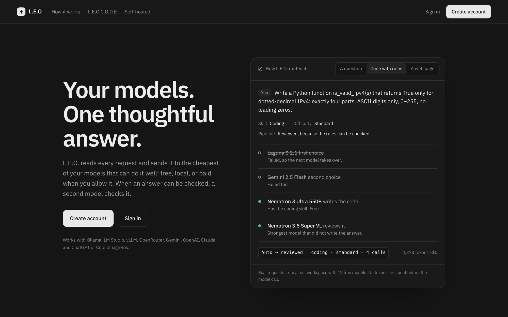

**The landing page** (`/welcome/`), shown to anyone who opens L.E.O. signed out. The panel replays how three real
requests were routed: a question, code with stated rules (two models failed, one wrote it, another reviewed it), and a
web page. Signing out returns here; a session that expires mid-chat goes straight back to sign-in.

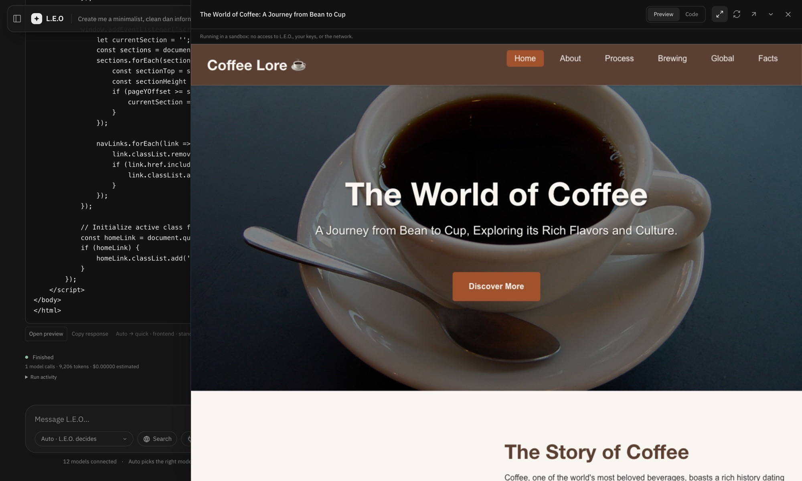

*"Create me a minimalist, clean dan informatic landing page about coffee"* in Auto mode. HEAD saw one
self-contained page and chose `Auto → quick · frontend · standard`: one call to a free model (Gemini 2.5 Flash), 9,206
tokens, 36 s. The page uses real Wikimedia photos with their photographers credited, and runs in the sandboxed preview
at desktop width. *(Real run)*

| Reviewed coding answer | Per-chat usage |
| --- | --- |
| 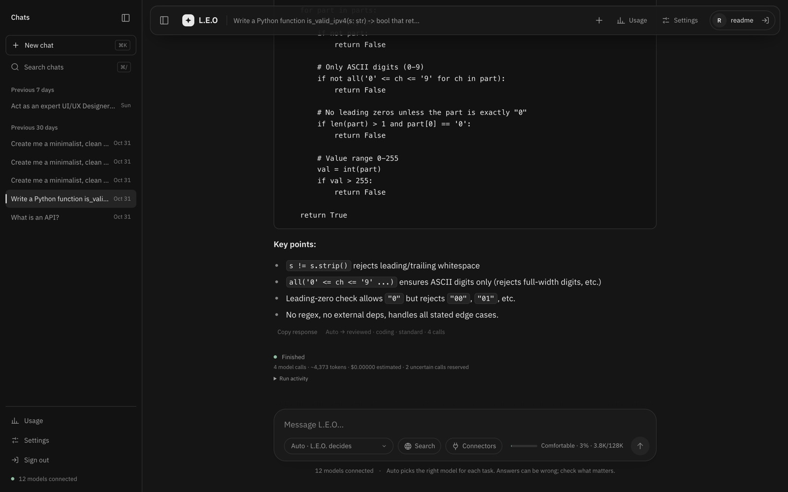 | 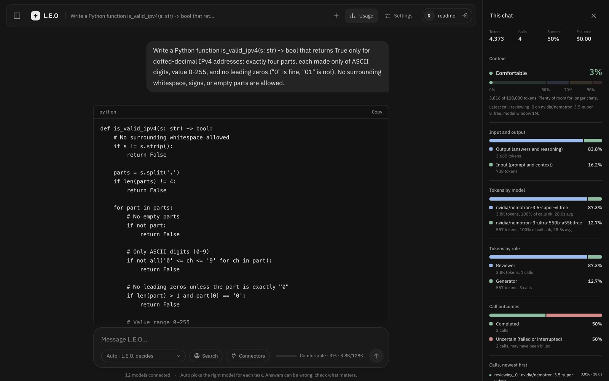 |
| HEAD chose `Auto → reviewed · coding · standard`. Two free models failed at once, Nemotron 3 Ultra wrote the code (557 tokens), and Nemotron 3.5 Super VL reviewed it (3,816 tokens). *(Real run)* | Context level, tokens by model and by role, and call outcomes. The two failed calls show as *uncertain*: their reservation still counts. *(Real data)* |
| **Usage across all chats** | **Settings → Models** |
| 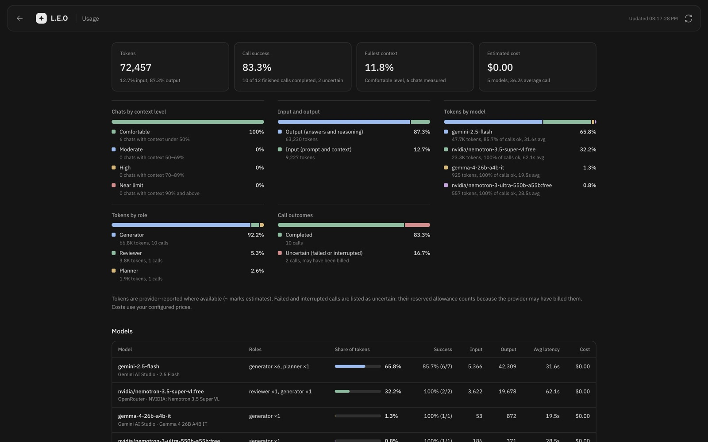 | 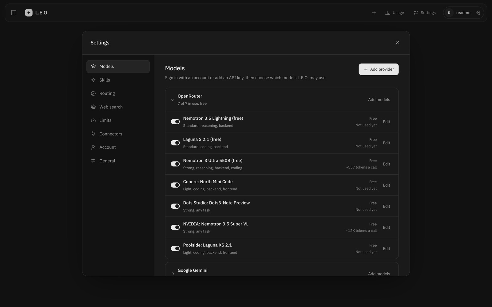 |
| Tokens, success rate, fullest context, and cost; shares by model, role, and outcome. *(Real data)* | One row per provider. Each model has a switch, a strength, skills, a price, and its average tokens per call. *(Real data)* |
| **Settings → Routing** | **The benchmark pages, side by side** |
| 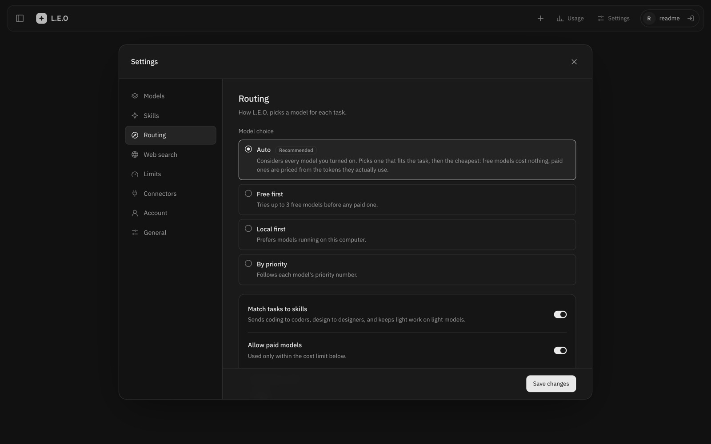 | 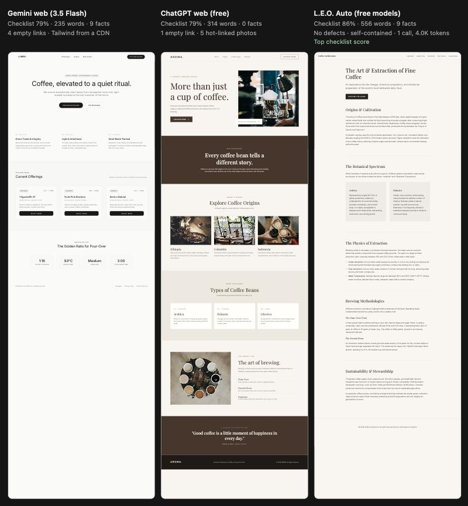 |
| **Auto** weighs every model you turned on: fit first, then cost per call. | See [Benchmarks](benchmarks.md). |

### L.E.O.C.O.D.E in the terminal

| Welcome | The tree at work |
| --- | --- |
| 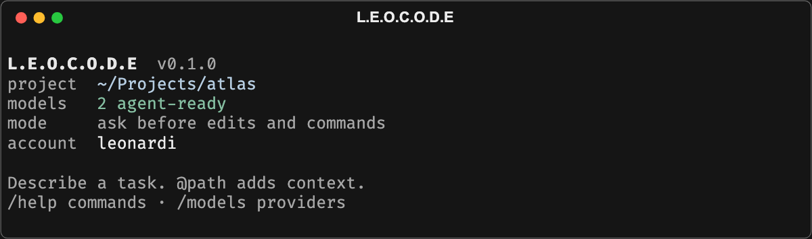 | 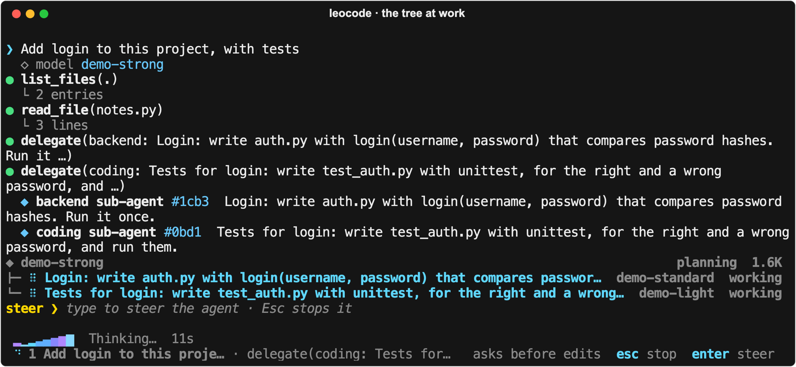 |
| **Approval before a change** | **Done: answer and tree** |
| 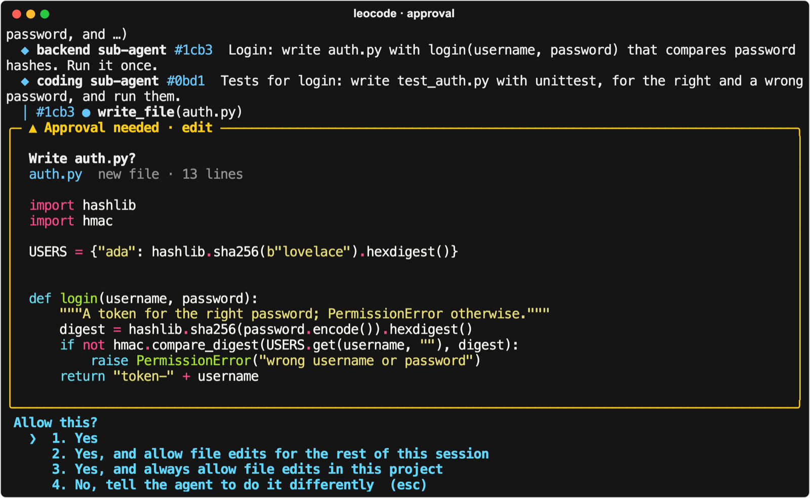 | 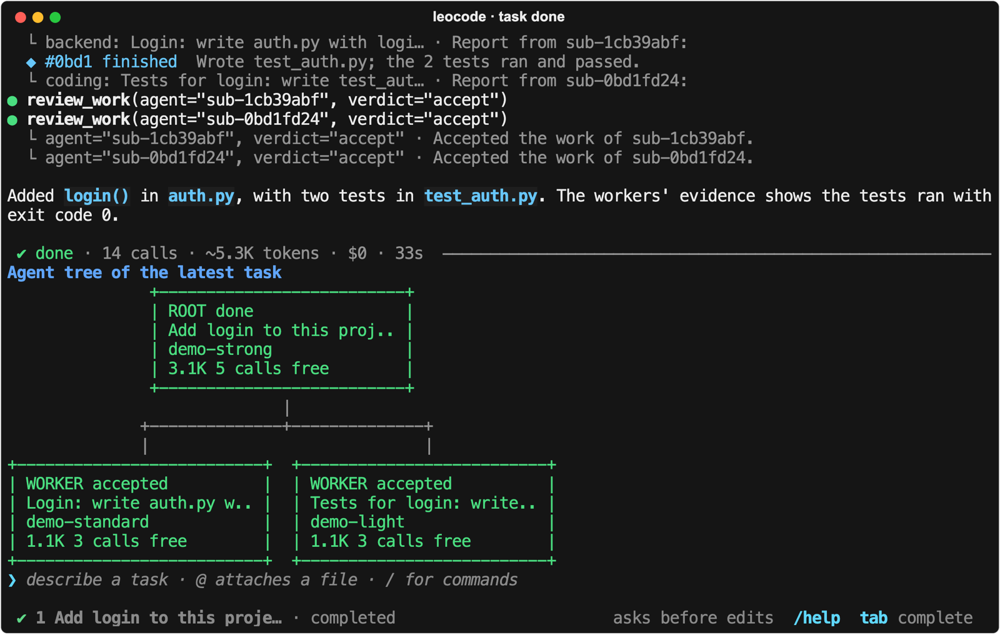 |

The real `leocode` in a terminal, on a demo project, with **scripted local models** (`demo-strong`,
`demo-standard`, `demo-light`) so the run is repeatable and costs nothing. The scripts only decide what each model
asks for. Everything else is real: the engine, the tree, the approvals, the files written, and the test run (`Ran 2
tests … OK`).

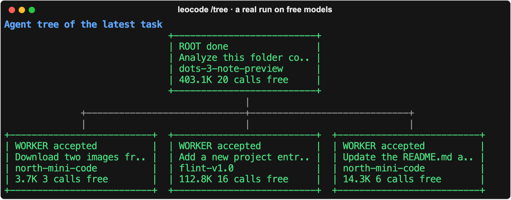

`/tree` of a **real** 4-agent run on free OpenRouter models: the root (Dots3-Note) split the task between three
workers on two strengths and accepted all three. 50 calls, 542K tokens, $0. The root alone used 403K of those tokens,
so the tree's cost goal is not met yet (see [Status](../README.md#project-status)). *(Real run)*
