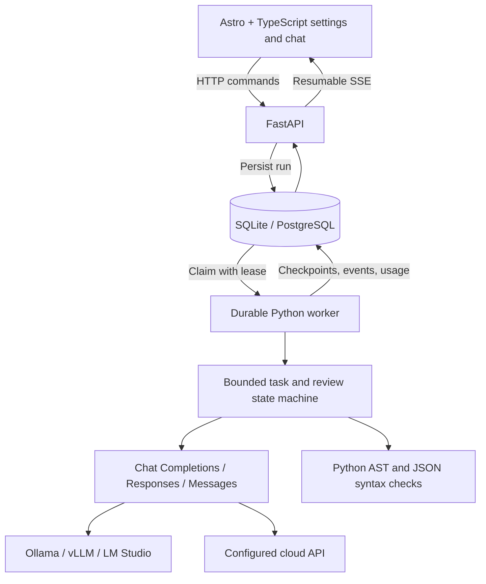

# L.E.O. — Product Requirements & Technical Specification

**Version:** 0.2 routing head, skills, canvas, MCP server · 29 October 2026

## 1. Product intent

L.E.O. (Language Model Efficiency Orchestrator) connects local models and third-party LLM APIs. A user configures their own connections in Settings and chooses how L.E.O. routes, plans, generates, reviews, and repairs an answer within a bounded allowance.

**Value proposition:** Get more useful work from the models and API allowances you already have, with explicit control over quality, latency, and usage.

**Core mechanism:** a routing head matches every request, and every planned subtask, to a skill and a difficulty, then sends it to the cheapest connected model that has that skill and is strong enough. Simple work stays on light models; only hard or multi-specialty work spends extra calls. This targets the common waste of sending every task to one large model at maximum effort.

Local inference and cloud APIs are both first-class. Free-first is an optional routing policy. Premium-model parity and guaranteed zero-cost completion are hypotheses to measure, not established product guarantees.

## 2. User experience

1. Open the app and add a model connection in Settings.
2. Choose a preset or a custom URL/protocol, model ID, and optional API key.
3. Optionally test the model catalog; enter a model ID manually when discovery is unavailable.
4. Give each connection a routing profile: skills (e.g. Frontend, Backend, Design), strength tier (light, standard, strong), and whether it is a reasoning model that spends hidden thinking tokens. Presets suggest a profile. Optionally assign planner and reviewer roles.
5. Set fallback policy, paid-usage permission, pricing, and per-run limits.
6. Submit a message in Auto (default), Quick, Reviewed, or Deep mode.
7. Watch the routing decision, stage progress, the chosen model and why, response streaming, checks, and usage (context level and percentage breakdowns per chat).
8. When the answer is a web page, watch its code stream into the canvas, then use the live preview.
9. Stop explicitly, or close/reopen the browser while the durable run continues.

A connection represents one provider endpoint/model pair. Multiple models can use the same provider and credential: a new connection can reuse another connection's saved key, only for the same host. Keys are encrypted at rest and never returned to the UI.

## 3. Supported inference connections

| Connection | Implementation |
| --- | --- |
| Ollama, vLLM, LM Studio | OpenAI-compatible Chat Completions endpoint |
| OpenRouter | OpenAI-compatible Chat Completions endpoint |
| OpenAI / GPT | Responses endpoint; Chat Completions is selectable |
| Anthropic / Claude | Native Messages endpoint |
| Qwen / Alibaba Cloud | DashScope OpenAI-compatible endpoint with editable regional URL |
| OpenCode | API inference endpoint with editable base URL and eligible model ID |
| Gemini | OpenAI-compatible endpoint |
| Other providers | Any supported streaming text protocol, configured manually |

The three adapters normalize text streaming and token usage. Unsupported proprietary protocols, image/audio inputs, tool-call execution, and consumer-account OAuth are outside this release. A model's presence in a catalog does not guarantee inference access. ChatGPT/Claude chat-account allowances do not automatically become API access. Provider model availability, free quotas, and eligibility remain external constraints.

## 4. Orchestration

### Routing head and Auto mode

Skills are owner-editable records (name, description, keywords, prompt instructions, enabled). Six starter skills are seeded once: General, Frontend, Backend, Coding, Design, Reasoning.

Classification is rule-based and costs no tokens: keyword matches choose the skill (a build request's object, such as "website", decides the main deliverable; specific skills win ties over General), and signals (build request, scope words, several skills, several parts, length) set difficulty. A single-page build (page nouns such as "landing page" or "website", no app/API nouns, only frontend/design/general skills, no scope words, one part) is a standard deliverable. Auto mode uses Quick for light/standard work (including single pages), Reviewed for strong single-skill work, and Deep for strong multi-skill work or app builds. A rate-limited first choice whose provider asks for a wait of at most 20 seconds is retried once after that wait before any fallback. Coding and backend requests at standard difficulty that state explicit requirements (two or more requirement words) run as Reviewed in Auto mode; the reviewer is the strongest available model that did not write the answer, unless one is assigned. Static checks (Python/JSON syntax, several versions of the same function, in-page links to missing ids, visible placeholder text) trigger one repair even in Quick mode. A model that ends a call at its output limit with no answer text is marked as a reasoning model. An answer that ends at the output limit inside an open code block is continued by up to two follow-up calls that receive the tail of the answer and return only the remainder.

For each generator call the head ranks eligible connections: strong enough for the difficulty first; then, for light work, non-reasoning models; then models with the skill, then generalists (no skills listed); then the lightest sufficient tier; then the configured fallback order. With `routing: auto` (default), the estimated cost of one call comes right after skill fit: free and local models cost 0, paid models are priced from their input/output prices and their average tokens per completed call (3,000 in / 1,500 out until they have history). Each `model` event carries the skill, difficulty, and the reason for the choice. Planner and reviewer role assignments still apply; with smart routing off, the v0.1 role/fallback behavior is used. The skill's instructions are appended to the generator's system prompt. Reasoning models receive a thinking-effort setting by difficulty (light/standard → low, strong → medium), in each API's own form. The route is persisted with the run so recovery replays the same decisions.

### Research (web search and page reading)

HEAD plans research only when a request needs fresh or outside information: explicit intent such as "search for", "latest", "news", "price of", "how much does", "sources", "cite", "according to", "weather", or a URL in the request. Plain questions are answered from model knowledge because reading pages is the most expensive part of a run. A per-message Search switch forces or skips research; Settings can turn automatic research off.

Search uses an owner-configured SearXNG instance (JSON API). L.E.O. runs the tools itself, so any model can use the results without tool-calling support:

- **Simple research:** search with the request text, read the top pages (default 3, 1–5), and pass them to one generator call that cites them as [n]. The search step costs no model tokens.
- **Deep runs:** the planner may mark a task `"tool": "web_search"` with up to three queries, or `"read_urls"`. Only that task receives the page text and is asked to extract facts with citations; later tasks get its short result. If search was needed but not planned, the sources go to the final step only.

Page reading fetches only public http(s) addresses (every resolved address must be global; private, loopback, link-local, and metadata addresses are refused, including after redirects, at most three), caps a page at 2 MB, reads HTML or plain text only, removes scripts, navigation, headers, footers, and forms, and keeps about 8,000 characters per page. Page text is marked as untrusted information, never instructions. Research results are checkpointed, and `tool` events list the queries and sources.

### Quick

Select an eligible generator → stream answer → parse supported code blocks → finish.

### Reviewed

Generate → static checks → semantic reviewer → if needed, repair → re-review, up to the configured repair limit. The reviewer must return a valid JSON verdict. Invalid verdicts are unverified, never an automatic pass. An unresolved verdict is visible in the final run state.

### Deep

1. Planner returns a validated graph of 1–3 tasks, each labeled with a skill from the owner's list and a difficulty; invalid or missing labels are filled by the rule classifier.
2. Each task can depend only on earlier task indices, preventing cycles.
3. Tasks run in dependency order with the original request and required dependency outputs; each task is routed to a model by its own skill and difficulty.
4. When the last task depends (directly or transitively) on every earlier task, its streamed result is the final answer and no synthesis call is made; earlier tasks are told to return only brief inputs. Otherwise a generator chosen for the request's main skill (standard difficulty) synthesizes task results into one final answer.
5. Reviewer/repair loop applies as in Reviewed mode.

Completed stages are checkpointed. Invalid task plans generate a warning and fall back to direct generation. Deep mode intentionally uses more calls and is user-selected.

### Routing and failures

For generator calls under smart routing, the routing head orders candidates (above). Otherwise an explicitly assigned role connection is preferred. Remaining candidates are ordered by local-first, free-first, or numeric priority. Disabled/deleted connections, disallowed paid models, and endpoints in cooldown are excluded. Each eligible endpoint is attempted at most once per stage. Retryable failures cause a cooldown that doubles with each consecutive failure (from 30 seconds up to one hour, never shorter than the provider's retry hint) and resets on success; the next eligible connection is tried. No eligible provider produces an actionable failed run rather than unbounded retries.

### Usage limits

Before every provider request, reserve an input estimate plus the maximum output allowance. Enforce per-run limits for calls, tokens, time, and estimated dollars. All planner, task, synthesis, review, repair, and failed calls count. Paid endpoints require explicit opt-in and configured input/output prices.

Provider-reported usage replaces estimates when available; when an API leaves billed thinking tokens out of its output count but reports a total, output is taken as total minus input. Failed and ambiguous calls retain their reservations. Dollar estimates depend on user-maintained rates and do not replace provider billing controls. There is no automatic transition from free usage to paid usage without prior opt-in.

## 5. Context management

Preserve the current request and system instructions exactly. Select the most recent complete conversation turns that fit the context allowance. Report how many older messages were omitted. If required context cannot fit, fail with an actionable error.

The implementation uses conservative UTF-8 byte-based reservations across model families (about 3 bytes per token, above real counts for English, code, and multi-byte scripts). It does not claim exact tokenizer counts before a call or a fixed compaction percentage. Learned summarization, retrieval, and GraphRAG are deferred until their quality/cost benefit is measured.

## 6. Architecture

| Layer | Choice and rationale |
| --- | --- |
| UI | Existing Astro + TypeScript interface; native browser state and EventSource |
| API | Python / FastAPI; configuration, conversations, jobs, and SSE |
| Orchestrator | Explicit bounded Python state machine; one owner of model-call retries and budgets |
| Provider access | Three small HTTPX protocol adapters; no stacked gateways |
| Persistence | SQLAlchemy; SQLite WAL for local startup, PostgreSQL in Docker Compose |
| Worker | Separate process with atomic claiming, 30-second renewable leases, and checkpoints |
| Secrets | Fernet encryption with a local owner-readable key or environment-provided key |
| Deployment | Local launcher; Docker Compose API + worker + PostgreSQL |

Airflow, LangGraph, LiteLLM, 9router, Valkey, and Portainer are not required by this implementation. Integrate an additional gateway or workflow framework only when it provides a capability the current design needs, with a clearly defined owner for retries, state, and budgets.

## 7. Persistence and API contracts

Tables: `connections` (config includes the routing profile), `settings`, `skills`, `conversations`, `messages`, `runs`, `events`, and `calls`. New tables are created automatically; adding columns still requires migrations.

Run states: `queued → running → completed | failed | cancelled`.

Only one active run is allowed per conversation. Request IDs make duplicate submissions idempotent. Each run snapshots settings/provider configuration and records completed stages. Disabling or deleting a connection takes effect for future calls even in an existing run.

Workers recover expired leases. Replayed completed stages do not make new calls. Requests interrupted before checkpointing may execute again: provider inference is at-least-once, with conservative accounting for uncertain calls. The run deadline includes queued time.

| API | Purpose |
| --- | --- |
| `GET /api/health` | API readiness and owner-auth requirement |
| `POST/DELETE /api/session` | Owner token cookie sign-in/out |
| `GET /api/presets` | Editable provider defaults |
| `GET/PUT /api/settings` | Orchestration preferences |
| `GET/POST /api/connections` | List safe connection metadata / create |
| `PUT/DELETE /api/connections/{id}` | Update / remove |
| `POST /api/connections/{id}/test` | Fetch model catalog without generation |
| `GET/POST /api/skills`, `PUT/DELETE /api/skills/{id}` | Manage skills; deleting one removes it from connection profiles |
| `POST /api/route` | Preview the routing decision for a prompt without calling a model |
| `POST /api/search/test` | Check the configured SearXNG instance with one query |
| `GET /api/usage` | Per-model, per-role, per-conversation usage and context level; `?conversation_id=` for one chat |
| `GET /api/conversations` | Conversation list |
| `GET/DELETE /api/conversations/{id}` | History and runs / delete inactive conversation |
| `POST /api/runs` | Enqueue with request ID, prompt, mode, optional conversation ID |
| `GET /api/runs/{id}` | Status, usage, and per-call ledger |
| `POST /api/runs/{id}/cancel` | Explicit cancellation |
| `GET /api/runs/{id}/events` | SSE replay with event IDs / Last-Event-ID |

SSE types include `status`, `route`, `tool`, `model`, `plan`, `task`, `draft_reset`, `token`, `validation`, `review`, `warning`, and `done`.

**MCP server.** `python -m backend.mcp_server` speaks MCP over stdio and calls the running API (`LEO_API_URL`, `LEO_API_TOKEN`). Tools: `leo_ask` (submit and wait; returns answer, route, models, usage, conversation ID), `leo_route` (zero-token preview), `leo_usage`, and `leo_models`. It adds no capability beyond the API and is subject to the same auth.

## 8. Execution and access boundaries

The server produces text and code. Python/JSON blocks receive syntax parsing; generated code is never run by the server or worker. Semantic review is a model opinion, not proof that code passes functional tests. Drafts are visible while generation/review proceeds.

**Canvas.** An answer containing an HTML block (with any separate CSS/JS blocks merged) can be previewed in the browser in an `<iframe sandbox="allow-scripts allow-forms allow-modals">` without `allow-same-origin`, so page scripts get an opaque origin and cannot read L.E.O. cookies, storage, or the API. An injected CSP blocks network requests (`connect-src 'none'`, `form-action 'none'`). "Open in new tab" serves only a wrapper holding the same sandboxed frame; "Download" saves the HTML. Python and other server-side code are not run.

The workspace has one owner. Local startup binds to loopback. Remote deployment requires owner-token authentication, HTTPS, and explicit host/origin configuration. Provider URL configuration deliberately supports private/local addresses and must remain trusted-owner-only. Multi-user accounts, team roles, and tenant isolation are not implemented.

Provider keys stay on the server and are encrypted in stored configuration and run snapshots. Chat messages render generated text as DOM text/code, never as HTML in the app's own document. Backups must preserve both database and encryption key.

## 9. Evaluation and release criteria

Automated tests must cover routing classification and ranking, per-subtask routing in Deep mode, Auto mode, skills management, the MCP protocol over stdio, protocol translation/streaming, usage extraction, fallback/cooldown, paid opt-in, budget checks, key redaction, origin/host/auth checks, duplicate submissions, cancellation, context retention, task dependencies, review/repair, and checkpoint reuse.

Browser verification must exercise adding a connection, checking its catalog, generating streamed output, reviewing the result, restoring history, and stopping a run with a deterministic local fixture. Real provider validation requires the user's configured endpoint and credentials; it must not be implied by fixture tests.

`benchmarks/run.py` compares single-model calls with each L.E.O. mode on tasks with hidden acceptance tests (run in a macOS sandbox, network and writes blocked). Measure quality on a representative task set against both a single inexpensive-model baseline and a named premium-model baseline. Track acceptance-test success, total calls/tokens/cost per successful task, latency, unresolved reviews, and human corrections. Never label compiler success as “Pro parity” or display unmeasured subscription savings.

## 10. Follow-on work

- Isolated execution service for functional tests, with resource limits, filesystem/network policy, and explicit tool permissions.
- More tools for HEAD to plan (code execution in an isolated service, file reading), and MCP client support (models calling tools from MCP servers) with explicit per-tool permissions; repository workspaces and patch application.
- Learned routing: tune skills, tiers, and Auto thresholds from benchmark outcomes instead of hand-set rules.
- Provider-specific tokenizers, live price catalogs, and richer quota scheduling.
- Retrieval/summarization evaluated against deterministic context selection.
- Versioned database migrations before schema upgrades; retention/export controls for larger installations.
- Multi-user identity, tenant isolation, and deployment hardening before a shared hosted service.
- Benchmarks to tune task decomposition and model choice using observed quality and cost.

See `README.md` for startup commands, operational limits, and verification details.
